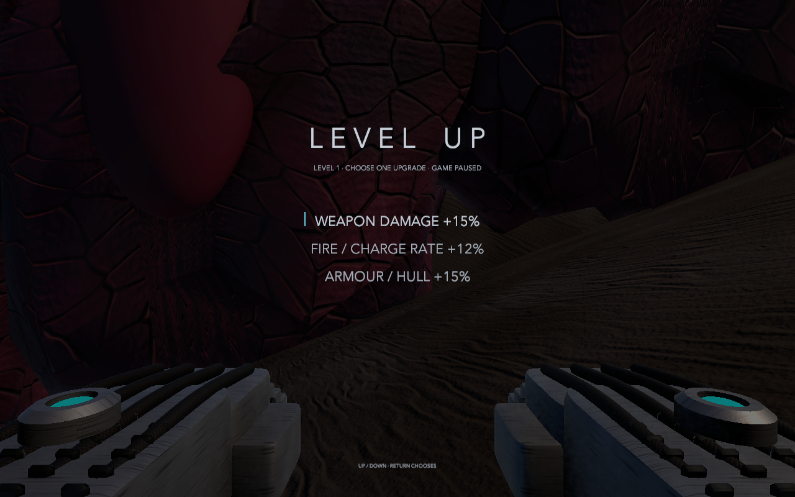

# Planet campaigns

Earth has three regional broods with one, two and three linked minds. Each region needs its own robodog factory to control the ground population. A shipyard requires all regions on that world to be controlled. Ground robots suppress alien bodies; robot pilots suppress the reproducing alien fleet. Individual kills create opportunities, while factories maintain control.

The mission table in `MISSIONS.md` is executable content. The encounter ideas below are the next design targets, not a claim that each specialised objective already exists.

| World | Identity and existing tools | Proposed encounter objective | Why behaviour changes |
|---|---|---|---|
| Earth | Emergency melee, then beam, surface thrusters and orbital booster | Three short regional burrows: entrance breach, branching nest, vertical brood | Learn one capability at a time; use digging to flank, then robots to hold cleared ground. |
| Luna | Low gravity, exposed ground turrets and flying guards; suit and ship missiles | Break air cover before opening the mind's shield | Use terrain and controlled boosts; reserve guided fire for machines and ships. |
| Mars | Breachers and spitters; suit rail and ship beams | Cut a tunnelling brood's reinforcement routes | Watch below as well as ahead; pierce narrow firing lanes or dig another approach. |
| Venus | Heat, reduced visibility and shields; cloak, heat plating and ship rail | Disable separated shield organs in a dense nest | Reposition under cloak and fight at close range, avoiding straight exchanges through shields. |
| Mercury | Bare terrain and heat; hull repair | Cross an exposed stronghold by carving temporary cover | Trade fast traversal against exposure; accuracy and resource recovery matter. |
| Titan | Dense swarms; heavier armour and hemisphere lasers | Defend the factory's first launch while dismantling the brood | Sweep crowds and protect your population-control foothold rather than chasing every alien. |
| Triton | Ice and late alien fleet production; nuclear torpedoes | Cripple fleet nurseries before the robot navy can take control | Interleave ground actions and fleet engagements. Torpedoes punish exposed groups, not enclosed minds. |
| Citadel | Indestructible organic labyrinth, relay minds and Spine turrets | Break the relay defence, kill the final core and escape | Navigate and prioritise threats; wall destruction and nuclear splash cannot skip the route. |

Optional later side expeditions could use Europa for under-ice traversal, Io for short volcanic raids and the asteroid belt for fleet interception. Add them only when they introduce a new decision; a different sky and a larger health bar are not enough. Generated systems should recombine established encounter rules and routes, add bodies and production pressure and preserve readable enemy health and damage.

Keep XP choices to damage, fire/charge rate, toughness, energy recharge and repair/reload. The mandatory level-up screen pauses play. Salvage purchases use the same understandable modifications. The first beam should remain useful through investment: higher damage, faster energy recovery and a later chaining milestone. Explain these mechanics through the companion as they become available.

Death restarts the current burrow. Completed regional objectives and permanent equipment remain. Do not award player XP for unlimited autonomous robot kills. Important movement equipment remains a guaranteed objective reward.
