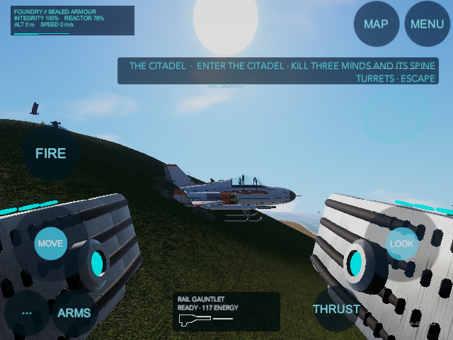

# Installing on iPhone, iPad, Windows and Steam Deck

Use Unity **6000.6.9f1**. Close the editor before building. This Mac has the iOS and Windows support modules installed. Build output stays in the ignored `Build/` directory. Each script prints progress and its final installation instructions. The pinned Burst compiler detects macOS by checking that the standard system directories, including `/Volumes`, exist. This build account is denied that directory check. In such a sandbox the scripts use managed terrain jobs. On a normal Mac account each exporter clears an unoptimised Bee result and checks the finished player for its native Burst library. A missing library fails that build. Use the normal-account export for terrain performance testing.

## iPhone and iPad

1. Connect the unlocked device by USB. Accept **Trust this computer** on the device. Enable **Settings > Privacy & Security > Developer Mode**, restart if asked and confirm it after restarting.
2. Open Xcode > Settings > Accounts and add your Apple Account. A personal team works for development on your own devices, subject to Apple's provisioning limits.
3. In a terminal at this repository, run `./script/build-ios`. It exports Unity, then runs **xcodebuild** to compile and link the actual device app. Logs are `Logs/build-ios.log` and `Logs/build-ios-xcode.log`.
4. The script reuses the signing team from your existing `Build/iOS/Unity-iPhone.xcodeproj`. For a clean checkout, supply `INFINIGAME_APPLE_TEAM=YOUR_TEAM_ID ./script/build-ios`, or use Xcode to choose your team first. Without a team it performs an unsigned compile, which cannot yet be installed. Use `./script/build-ios --unsigned` explicitly to check compilation on an account without Apple signing credentials.
5. A successful local build opens `Infinigame.xcodeproj` in Xcode. Select the **Unity-iPhone** scheme and your connected iPhone or iPad as the destination. Under the Unity-iPhone target's **Signing & Capabilities**, select your team and leave **Automatically manage signing** enabled. The bundle identifier is `com.mikemcquaid.Infinigame`.
6. Choose **Product > Run**, or press **Cmd-R**. Xcode installs and launches the game. For a device-signed build already produced by the script, use **Window > Devices and Simulators > your device > Installed Apps > +**, then select the `.app` in `Build/iOSDerived/Build/Products/Release-iphoneos/`.
7. If the device asks to trust your developer profile, use **Settings > General > VPN & Device Management**. The device uses its mobile quality settings automatically.

Automatically manage signing is correct. Accepting Xcode's recommended settings is normally fine. Unity can overwrite changes made only in its exported Xcode project, so persistent export fixes belong in the repository. The exporter now links **SafariServices.framework**, which supplies the previously missing `SFSafariViewController`, as well as the frameworks needed for voice input.

See [Apple's build and run guide](https://developer.apple.com/documentation/xcode/building-and-running-an-app) and [Developer Mode](https://developer.apple.com/documentation/xcode/enabling-developer-mode-on-a-device). TestFlight or App Store distribution is separate from these local installation steps.

## Windows and SteamVR

1. Run `./script/build-windows` on this Mac. It builds `Build/Windows/Infinigame.exe`, its data and DLLs, then packages **Build/Infinigame-Windows.zip**. Read `Logs/build-windows.log` if it fails.
2. Copy that zip to the Windows PC by USB, AirDrop alternative or file sharing. Right-click it > **Extract All**. Keep the whole extracted **Infinigame** folder together. Double-click **Infinigame.exe** to play. Copying only the exe will not work.
3. For VR, install Steam and SteamVR, connect the headset and controllers and complete SteamVR room setup. In **SteamVR Settings > OpenXR**, choose **Set SteamVR as OpenXR Runtime**. Choose **Infinigame-VR.exe** to start OpenXR. The launcher initialises Direct3D 11 in a window that fits the desktop work area. After OpenXR starts, the player requests a right-eye mirror in a native-resolution borderless window covering the monitor. SteamVR sets the headset resolution independently. **Infinigame.exe** opens on the monitor at its current desktop resolution, including when SteamVR is running. Desktop launches default to borderless full screen. Explicit Steam window and resolution arguments override this default.
4. On foot, the left stick moves and the right stick snap-turns. Hold left trigger to jump or use the jetpack, and left A to descend. Push the movement stick fully forwards, click it or squeeze a grip to sprint on foot. Right A interacts, collects factory equipment and boards or leaves the ship. Right B or a vertical flick of the right stick cycles suit weapons. Punch with a tracked hand. Hold right trigger to aim the railgun or suit missiles and release to fire. Right stick click toggles cloak on foot or autopilot in flight.
5. Tap left B to open the map or hold it to pause. In menus, move either stick up or down and squeeze either trigger or press right A to select. Point at a button to highlight it and squeeze a trigger to choose it. On the map, the left stick pans and the right stick zooms. Right B goes back. Turn the back of your left forearm towards your eyes to reveal its wrist display. Choose **Build > Robodog factory** on the wrist to construct a factory. From the third burrow, call your escort from the wrist or expedition summary.
6. Boarding centres the pilot’s view. Move the left stick up or down for forward or reverse thrust and sideways to steer. The right stick pitches vertically and rolls horizontally. Left trigger boosts while you apply thrust and left A descends. **Ship stick pitch** in Settings reverses vertical steering. Aim with the windscreen sight and hold left B to reach the pause menu from the cockpit. Choose **Main menu** from any expedition tab to open the pause menu.
7. Open **Settings > VR fist alignment** to adjust palm setback or rotate the gloves in five-degree steps. The Index defaults are 90° pitch, −22° inward yaw and 80° roll, with the gloves 11 cm towards the elbows from the tracked palms.
8. Open **Settings > VR wrist display** to adjust distance towards the elbow, height above the arm, rotation around the forearm and screen rotation. The watch face starts 25 cm along the left forearm from the glove centre, 11 cm high and rotated 90°. The alignment pages show offsets from these defaults, so zero restores the fitted pose. Each page previews its fit and has its own reset. Reading the watch clears the visor gauges and prompts until you lower your arm. [Watch fit with a simulated Index pose](docs/index-wrist.jpg)

In the cockpit, pulse cannons lead a moving target within seven degrees of the ship’s nose. Beams and rails correct towards a visible target in the same cone. Walls, terrain and shields block assistance.

The build uses Unity's official OpenXR loader and Valve Index profile. Other headset bindings require device testing. See [Unity's OpenXR setup](https://docs.unity3d.com/Packages/com.unity.xr.openxr@1.17/manual/project-configuration.html).

If Steam reports “Couldn't switch to requested monitor resolution”, check that the shortcut points to the newly extracted executable and clear any old width, height or graphics API overrides from its launch options. The VR startup line in `%USERPROFILE%\AppData\LocalLow\Infinigame\Infinigame\Player.log` records the mirror size, window mode and graphics API. [Unity player launch options](https://docs.unity3d.com/6000.0/Documentation/Manual/PlayerCommandLineArguments.html)

### Windows playtests through Steam

Once admitted to **Infinigame Playtest**, install it from your Steam library. Choose the desktop launch option for a monitor or Steam Deck and the VR option for a headset. Steam delivers subsequent builds through the same library entry. The playtest needs its own AppID and approval before testers can join. [Playtest setup and uploads](CI.md#steam-playtest-for-windows)

## Steam Deck

1. Run **`./script/build-steam-deck`**. This runs the same exporter as **script/build-windows** and produces **Build/Infinigame-Windows.zip**. Choose Infinigame.exe for monitor play on Deck. No Linux Unity module is required.
2. On Deck, hold Power > **Switch to Desktop**. Copy the zip to **Documents**, then extract it. Keep the entire **Infinigame** folder.
3. Open Steam > **Games > Add a Non-Steam Game to My Library > Browse**. Change the file filter to all files if needed and choose **Documents/Infinigame/Infinigame.exe**.
4. In that entry's **Properties > Compatibility**, enable **Force the use of a specific Steam Play compatibility tool**, then select **Proton Experimental**. Return to Gaming Mode and launch it.
5. Choose **Gamepad with Mouse Trackpad** in Steam Input. Left stick moves and either stick navigates menus, right stick looks, RT fires, LT scans on foot and boosts in the ship, A jumps/confirms, X interacts, Y changes weapon and Menu pauses. View toggles the map. D-pad Right recalls the ship or starts autopilot. LT + D-pad Down builds the available regional structure and LT + D-pad Left opens typed robot dialogue. Touch, the trackpad and an attached keyboard/mouse also work. The pointer stays free for HUD actions and cockpit switches; use the right stick or drag with the right mouse button to look. Set **Properties > General > Game Resolution > Native** if Steam supplies a square desktop. Start at **1280×800, Mobile detail**.

Win64 is correct here: this route intentionally uses Proton to run the Windows player, with XR startup disabled. A separate native Linux build would require another Unity module and another validation target. Valve documents [Windows games through Proton](https://partner.steamgames.com/doc/steamhardware/proton). It is a local sideload, not a Steam store release or a Deck Verified build. Native Deck dictation is not implemented; use the on-screen keyboard (Steam + X) for robot dialogue. Valve documents [adding a non-Steam game](https://help.steampowered.com/en/faqs/view/671A-4453-E8D2-323C) and [forcing Proton compatibility](https://help.steampowered.com/en/faqs/view/7DD4-C618-182E-0E49).

## Sending regular builds from your Mac

Install [LocalSend](https://localsend.org/download) on the Mac, Windows PC and Deck (the Linux version in Desktop Mode). Open it on both machines on the same Wi-Fi or Ethernet network. On the Mac choose **Send > File**, choose `Build/Infinigame-Windows.zip`, select the destination and accept there. This is free local network transfer with no account. Close the game before replacing its extracted `Infinigame` folder. Keep the same path on Deck so its Steam shortcut remains valid. Saves live outside the build folder.

For unattended repeat transfers after SSH is configured, `rsync -av --delete Build/Windows/ deck@YOUR_DECK:~/Games/Infinigame/` updates an existing dedicated game directory. The deletion flag is only appropriate for that build directory, never a general Documents directory. LocalSend needs less setup.

## Touch and keyboard

Tap Fire for every touch weapon. Beams fire a short burst; railguns charge and release automatically after a tap. Stronger touch aim assistance pulls a settling crosshair towards enemies within 14 degrees on foot or 18 degrees in a ship. Shots can correct by up to 10 degrees on foot or 12 degrees in a ship; terrain, walls and shields still block targeting. Keyboard, gamepad and VR retain held beams and hold/release rails. Touch open space on the left and drag from where your thumb lands to move. Push fully forwards to sprint. Swipe on the right to look, lift and swipe again to turn further. Both thumbs work together. A short tap on either side also fires. Health, energy, recharge and XP sit below the mission on the left of the upper half of the safe area. The equipped weapon sits opposite. Both readouts clear the thumb controls on phones and tablets. Lift and contextual Use are on the right; Map and Menu are at the top. The weapon selector stays on the left. The **···** tray holds Recall, Build, Robot, microphone, scan, camera, cloak, descent and flight assist. First recall stays hidden until you reach orbit; other locked equipment actions stay hidden. Tap cockpit weapon lamps, assist, autopilot, landing, selector, trigger or the range display to use them. Steam Deck also supports these touch actions. Windows and macOS share the desktop HUD, with suit instruments at the lower left and radar at the upper right. Hold Alt to free the desktop pointer. A hardware keyboard on iPad uses the desktop bindings immediately; touch stays available. In keyboard flight, WASD strafes and climbs, Space thrusts forwards and Ctrl or C reverses. The controls overlay and tutorial follow the last input method.

## Voice and accessibility

Settings has independent **Robot voice** and **Robot subtitles** controls. Toggle the synthesised robot voice or the subtitles. Switching off the last active output enables the other. All spoken dialogue uses the same offline engine and model on Mac, Windows, SteamVR, Steam Deck, iPhone and iPad. Essential tutorial and danger text remains visible with subtitles off. See [LLMS.md](LLMS.md#voice-choices) for implementation and listening details. The desktop and mobile frame target is 60. VR presentation follows the headset compositor.

With a connected language model, hold **Y**, touch **Mic**, use gamepad **LT + R3** or hold **Voice** on the Index wrist display. Release to send. Dictation opens the conversation. Recognised text appears in the same editable draft as typing, then the reply appears there. Keyboard Return still opens typed conversation. Native speech requires a device build and microphone permission.

Hold **Fire** on the touch display for sustained fire. The weapon name and silhouette sit at the lower right. **Recharge** shows when the selected weapon can fire again. Each weapon keeps its own timer while you switch. On the radar, a large cyan contact marks the objective. Solid red contacts are ahead and hollow red contacts are behind.

## HDR and hardware checks

Desktop HDR output starts automatically when Unity and the active display support it, with SDR fallback. Windows must have HDR enabled in its display settings. Desktop tone mapping uses detected display brightness and paper white. iPhone and iPad request HDR on compatible displays, with neutral tone mapping, a 203-nit reference white for the HUD and bloom disabled. Mobile, Windows and VR combat use matte creature surfaces and suppress blast lamps and large impact flashes. VR keeps its existing SDR camera. Steam Deck HDR through Proton and the OLED panel needs an actual device check. See [Unity's HDR compatibility](https://docs.unity.com/en-us/engine/6000.5/manual/materials-and-shaders/graphics-color/hdr/hdr-in-urp/hdr-output).

The first intended mobile devices are the owner's iPhone 18 Pro and 13-inch M4 iPad Air. Automated Mac tests cannot establish their frame rate, heat, signing success or headset comfort. On each device, test the buried opening, motion/touch punches, the first burrow, ship rendezvous, factory upgrades, voice permission denial, save deletion and the ending. HDR brightness needs inspection on a real HDR display.

For Mac performance testing, run `./script/play`, play normally for several minutes, quit and run `./script/performance`. It summarises the latest player session in `Logs/frames.log` and excludes menus. See [PERFORMANCE.md](PERFORMANCE.md).

## Validation

On 22 November 2026 all 631 EditMode and 133 PlayMode tests passed in Unity, including the screenshot tour. Coverage includes Index menu inputs, flight controls, wrist orientation, cockpit instruments through moonfall, matte enemy rendering, live speech across a pause, factory and shipyard respawns and jet-assisted ground escorts. The headset checks use simulated poses and the language model and dictation checks use stand-ins.

The macOS arm64, Windows x64/SteamVR, Steam Deck and unsigned iOS arm64 players built on 22 November. All four archives passed an integrity check. Xcode compiled and linked the iOS device app. The sandbox disables Burst. Frame rate, physical Valve Index alignment and microphone permissions need checks on the target hardware.

## Steam shortcut artwork

In Steam Deck Desktop Mode, open the Infinigame shortcut's **Properties > Shortcut**, click the small icon beside its name and choose the included `Infinigame.png`. For the library tile, right-click its tile and choose **Manage > Set custom artwork**; the shortcut icon and library artwork are separate. The build archives include the game's existing icon alongside the executable. Keep that image at the same path when updating builds.

Proton Experimental is the starting compatibility choice used by this repository's Deck build instructions. If a future Experimental update causes a regression, try the current stable Proton release in the same Compatibility selector. Neither choice substitutes for testing on the Deck.

## Retrieving iPhone and iPad performance logs

The device build writes `frames.log` in the application's Documents directory. After reproducing a slowdown for a few minutes, connect the device to your Mac, open Xcode's device manager, select Infinigame under installed applications and use **Download Container**. Open the downloaded `.xcappdata` package and find `AppData/Documents/frames.log`. Copy it into this repository's ignored `Logs/` folder and run `./script/performance Logs/ipad-frames.log` (using the copied file's actual name).

For a stall that the summary cannot explain, use Xcode **Product > Profile** on the connected device. Use Time Profiler for CPU stalls and Metal System Trace for rendering. Measure a release build on the device, not the simulator. Record whether the slowdown happens when entering a burrow, spawning a corpse, opening a factory or entering orbit. Apple's [Metal tools](https://developer.apple.com/metal/tools/) explain the GPU capture and trace tools.

## Automated distribution

[CI.md](CI.md) documents the shared GitHub Actions builds, release workflow, required Unity/Apple secrets and TestFlight setup. Pushes to `main` publish the Windows, Steam Deck and Mac ZIPs, each rooted at `Infinigame/`. The Mac download uses a copy of the TestFlight archive and stays available if Apple rejects the upload. The root `Infinigame.xcodeproj` symlink opens the generated mobile project after a local iOS export.

In **Settings > Difficulty**, choose Creative, Easy, Normal, Hard or Realistic. Normal uses the original damage values. Creative lets the suit and hull take damage down to one point and one hit defeats an exposed enemy. Realistic quadruples damage in both directions. Choose a difficulty when creating a slot. Changing it during play updates that expedition. Older saves inherit the previous device setting.
