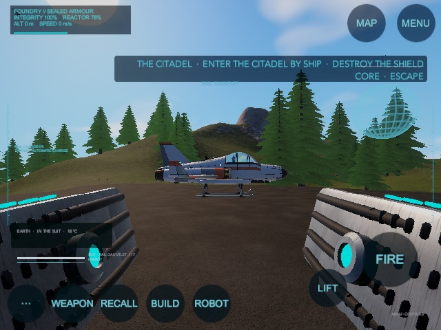

# Installing on iPhone, iPad, Windows and Steam Deck

Use Unity **6000.6.9f1**. Close the editor before building. This Mac has the iOS and Windows support modules installed. Build output stays in the ignored `Build/` directory. Each script prints progress and its final installation instructions. In a sandbox without Burst support, the scripts say so; rebuild from your normal Mac account before performance testing or choosing graphics settings. Missing-Burst caches are cleared for every target.

## iPhone and iPad

1. Connect the unlocked device by USB. Accept **Trust this computer** on the device. Enable **Settings > Privacy & Security > Developer Mode**, restart if asked and confirm it after restarting.
2. Open Xcode > Settings > Accounts and add your Apple Account. A personal team works for development on your own devices, subject to Apple's provisioning limits.
3. In a terminal at this repository, run `./script/build-ios`. It exports Unity, then runs **xcodebuild** to compile and link the actual device app. Logs are `Logs/build-ios.log` and `Logs/build-ios-xcode.log`.
4. The script reuses the signing team from your existing `Build/iOS/Unity-iPhone.xcodeproj`. For a clean checkout, supply `INFINIGAME_APPLE_TEAM=YOUR_TEAM_ID ./script/build-ios`, or use Xcode to choose your team first. Without a team it performs an unsigned compile, which cannot yet be installed. Use `./script/build-ios --unsigned` explicitly to check compilation on an account without Apple signing credentials.
5. Open `Build/iOS/Unity-iPhone.xcodeproj`. Select **Unity-iPhone** in the scheme selector, then your connected iPhone or iPad as the destination, rather than a simulator. Under the Unity-iPhone target's **Signing & Capabilities**, select your team and leave **Automatically manage signing** enabled. The bundle identifier is **com.mikemcquaid.infinigame**.
6. Choose **Product > Run**, or press **Cmd-R**. Xcode installs and launches the game. For a device-signed build already produced by the script, use **Window > Devices and Simulators > your device > Installed Apps > +**, then select the `.app` in `Build/iOSDerived/Build/Products/Release-iphoneos/`.
7. If the device asks to trust your developer profile, use **Settings > General > VPN & Device Management**. Start with Mobile detail and test a sustained battle before increasing it.

Automatically manage signing is correct. Accepting Xcode's recommended settings is normally fine. Unity can overwrite changes made only in its exported Xcode project, so persistent export fixes belong in the repository. The exporter now links **SafariServices.framework**, which supplies the previously missing `SFSafariViewController`, as well as the frameworks needed for voice input.

See [Apple's build and run guide](https://developer.apple.com/documentation/xcode/building-and-running-an-app) and [Developer Mode](https://developer.apple.com/documentation/xcode/enabling-developer-mode-on-a-device). TestFlight or App Store distribution is separate from these local installation steps.

## Windows and SteamVR

1. Run `./script/build-windows` on this Mac. It builds `Build/Windows/Infinigame.exe`, its data and DLLs, then packages **Build/Infinigame-Windows.zip**. Read `Logs/build-windows.log` if it fails.
2. Copy that zip to the Windows PC by USB, AirDrop alternative or file sharing. Right-click it > **Extract All**. Keep the whole extracted **Infinigame** folder together. Double-click **Infinigame.exe** to play. Copying only the exe will not work.
3. For VR, install Steam and SteamVR, connect the headset and controllers and complete SteamVR room setup. In **SteamVR Settings > OpenXR**, choose **Set SteamVR as OpenXR Runtime**. Start SteamVR, then the game.
4. Left stick moves, right stick snap-turns and right grip interacts. Fists use the speed of your tracked hand movements, with a short cooldown; the trigger fires other weapons. Left grip plus left A opens robot dialogue. Hold left grip plus right-stick click for dictation and release to send. Point the right controller at menu items and pull its trigger to select. Raise your left forearm for Build, Map, Recall, Robot, Scan, Cloak, Weapon and Menu. Touch its buttons with the right hand or point and trigger. Cockpit weapon lamps, assist, autopilot, landing, selector, trigger and range display also respond to hand contact. Recentre VR in the pause menu calibrates the current standing pose.

The build uses Unity's official OpenXR loader and Valve Index profile. Other headset bindings require device testing. See [Unity's OpenXR setup](https://docs.unity3d.com/Packages/com.unity.xr.openxr@1.17/manual/project-configuration.html).

## Steam Deck

1. Run **`./script/build-steam-deck`**. This makes a Windows desktop build with automatic XR startup disabled and packages **Build/Infinigame-SteamDeck.zip**. No Linux Unity module is required.
2. On Deck, hold Power > **Switch to Desktop**. Copy the zip to **Documents**, then extract it. Keep the entire **Infinigame** folder.
3. Open Steam > **Games > Add a Non-Steam Game to My Library > Browse**. Change the file filter to all files if needed and choose **Documents/Infinigame/Infinigame.exe**.
4. In that entry's **Properties > Compatibility**, enable **Force the use of a specific Steam Play compatibility tool**, then select **Proton Experimental**. Return to Gaming Mode and launch it.
5. Choose **Gamepad with Mouse Trackpad** in Steam Input. Left stick moves and navigates menus, right stick looks, RT fires, LT scans, A jumps/confirms, X interacts, Y changes weapon and Menu pauses. View toggles the map. D-pad Right recalls the ship or starts autopilot; LT + D-pad Down opens the factory uplink and LT + D-pad Left opens typed robot dialogue. Touch, the trackpad and an attached keyboard/mouse also work. The pointer stays free for HUD actions and cockpit switches; use the right stick or drag with the right mouse button to look. Set **Properties > General > Game Resolution > Native** if Steam supplies a square desktop. Start at **1280×800, Mobile detail**.

Win64 is correct here: this route intentionally uses Proton to run the Windows player, with XR startup disabled. A separate native Linux build would require another Unity module and another validation target. Valve documents [Windows games through Proton](https://partner.steamgames.com/doc/steamhardware/proton). It is a local sideload, not a Steam store release or a Deck Verified build. Native Deck dictation is not implemented; use the on-screen keyboard (Steam + X) for robot dialogue. Valve documents [adding a non-Steam game](https://help.steampowered.com/en/faqs/view/671A-4453-E8D2-323C) and [forcing Proton compatibility](https://help.steampowered.com/en/faqs/view/7DD4-C618-182E-0E49).

## Sending regular builds from your Mac

Install [LocalSend](https://localsend.org/download) on the Mac, Windows PC and Deck (the Linux version in Desktop Mode). Open it on both machines on the same Wi-Fi or Ethernet network. On the Mac choose **Send > File**, choose `Build/Infinigame-Windows.zip` or `Build/Infinigame-SteamDeck.zip`, select the destination and accept there. This is free local network transfer with no account. Close the game before replacing its extracted `Infinigame` folder. Keep the same path on Deck so its Steam shortcut remains valid. Saves live outside the build folder.

For unattended repeat transfers after SSH is configured, `rsync -av --delete Build/SteamDeck/ deck@YOUR_DECK:~/Games/Infinigame/` updates an existing dedicated game directory. The deletion flag is only appropriate for that build directory, never a general Documents directory. LocalSend needs less setup.

## Touch and keyboard

Tap Fire for every touch weapon. Beams fire a short burst; railguns charge and release automatically after a tap. Mild aim assistance bends shots by at most two degrees towards a living enemy within four degrees of the crosshair, with terrain, walls and shields still blocking shots. Keyboard, gamepad and VR retain held beams and hold/release rails. Drag the left side to move and the right side to look. Lift and contextual Use sit beside Fire; Map and Menu are at the top. Weapon, Recall, Build and Robot are directly accessible along the bottom. The small **···** tray adds microphone, scan, camera, cloak, descent and flight assist. Tap cockpit weapon lamps, assist, autopilot, landing, selector, trigger or the range display to use them. These HUD actions are also clickable on Windows and Deck; hold Alt to free the pointer on desktop Windows. The Mac HUD remains unchanged. A hardware keyboard on iPad uses the desktop bindings immediately; touch stays available. The controls overlay and tutorial follow the last input method.

## Voice and accessibility

Settings has independent **Robot voice** and **Robot subtitles** controls. Essential tutorial and danger text remains visible with subtitles off. Mac uses installed voices, Windows uses local SAPI speech through PowerShell and iPhone/iPad uses Apple's speech synthesiser. The robot option adds a synthetic tone. Deck falls back to text when Windows speech services are unavailable under Proton.

Hold **Y**, touch **Mic**, gamepad **LT + R3** or Index **left grip + right-stick click**. Release to send. Partial text appears in the HUD when the recogniser supplies it, and the reply stays in the HUD. This does not open the conversation menu. Keyboard Return still opens typed conversation. Native speech requires a device build and microphone permission.

## HDR and hardware checks

HDR output starts automatically when Unity and the active display support it, with SDR fallback. Windows must have HDR enabled in its display settings. The neutral tone mapper uses detected display brightness and paper white. Mac Metal and iOS 16+ are supported by Unity; a particular panel still needs HDR capability. Steam Deck HDR through Proton and the OLED panel needs an actual device check. See [Unity's HDR compatibility](https://docs.unity.com/en-us/engine/6000.5/manual/materials-and-shaders/graphics-color/hdr/hdr-in-urp/hdr-output).

The first intended mobile devices are the owner's iPhone 18 Pro and 13-inch M4 iPad Air. Automated Mac tests cannot establish their frame rate, heat, signing success or headset comfort. On each device, test the buried opening, motion/touch punches, the first burrow, ship rendezvous, factory upgrades, voice permission denial, save deletion and the ending. HDR brightness needs inspection on a real HDR display.

For Mac performance testing, run `./script/play`, play normally for several minutes, quit and run `./script/performance`. It summarises the latest player session in `Logs/frames.log` and excludes menus. See [PERFORMANCE.md](PERFORMANCE.md).

## Validation

On 16 November 2026, `script/test` passed all 593 core tests. Thirty distinct targeted Unity scene checks passed across the revision runs, including touch plus keyboard input, map toggling, pause-menu cheats, burrow defenders, demolition, factory deployment, cockpit hit areas and forearm touch/pointer selection. This is targeted coverage, not a fresh run of every scene test.

`script/build`, `script/build-windows`, `script/build-steam-deck` and `script/build-ios --unsigned` all succeeded. The iOS result includes Xcode compilation and linking of the arm64 device app. Both desktop zips were checked for the `Infinigame/Infinigame.exe` path. These sandbox builds lack Burst; rebuild from the normal Mac account for performance testing. Hardware validation is still required for Apple signing and microphones, Windows speech, Steam Deck resolution and Valve Index comfort. See the current commit's test results rather than treating compilation as a device play test.
