# Infinigame

A procedural solar system to explore in powered armour and by ship. The first system is a tiny copy of our own, with spherical worlds, seas, forests, weather and strange life. Beyond its gate are generated systems with their own worlds, living moons and sometimes two stars. Scan anything and Claude or ChatGPT writes its journal entry.

You wake buried, with no memory. A recovery robot helps wake your suit and stays on the radio, later joining the ship as copilot. The enemy is one presence with many bodies. Each outpost shelters a controlling mind: destroy it and its bodies scatter. Shields stop fire from outside, including nuclear torpedoes, so you must enter the rooms, hack their terminals or break in with powered fists.

Recovered equipment gives you choices. Fit three suit modules within six units of power at a robot workshop. Beams, thrusters, missiles, a rail gauntlet, heavy plate, a cloak and a capacitor compete for those slots. Beams, flight and shielding share your energy reserve. The suit survives vacuum, radiation and furnace heat, but reaching space is still the ship's job.

Liberated worlds support robot colonies. Blast rock for ore, collect polar or lunar ice and recover salvage from wrecks. Robots build depots, mines, drills, turrets, radar masts and workshops, then more robots. The presence spreads with time played, blights worlds and raids colonies; reclaiming a world pushes it back. There is no timed game over.

The ending has two stages. Fly through the citadel's turning tunnels, destroy the shield core and escape before it collapses. Then have a colony build engines to drop a small moon onto the final mind's world. The surviving colonies can power the repaired gate. The robot knows why opening it earlier would have been a terrible mistake.

Built with Unity 6.6 (6000.6.9f1) and URP. Everything is generated from code: terrain, models, textures, materials, the interface, sound effects and music. Official Unity packages provide engine and platform support; there are no downloaded art assets, though you can drop in music of your own.

The texture and model generators, shaders, material settings and Unity metadata belong in Git. Surface colour, height and normal maps are generated in memory, so there are no exported texture copies to commit. The application icon and the small documentation pictures below also stay in normal Git. Build output, Unity's cache and test captures stay ignored.

| | |
|---|---|
|  | 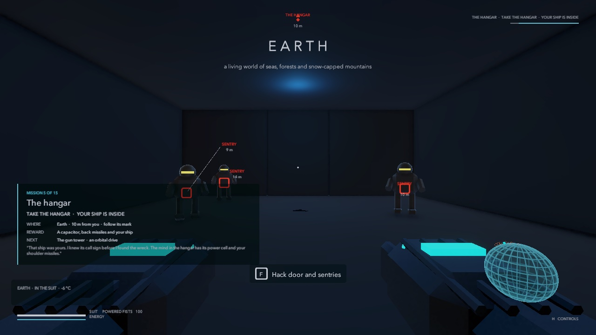 |
| 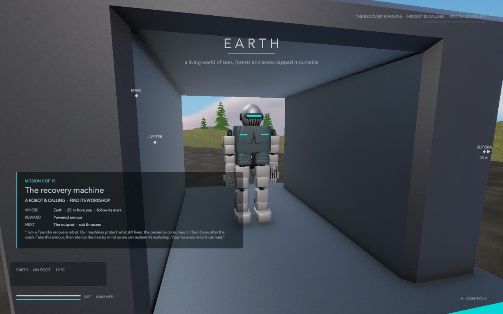 |  |
| 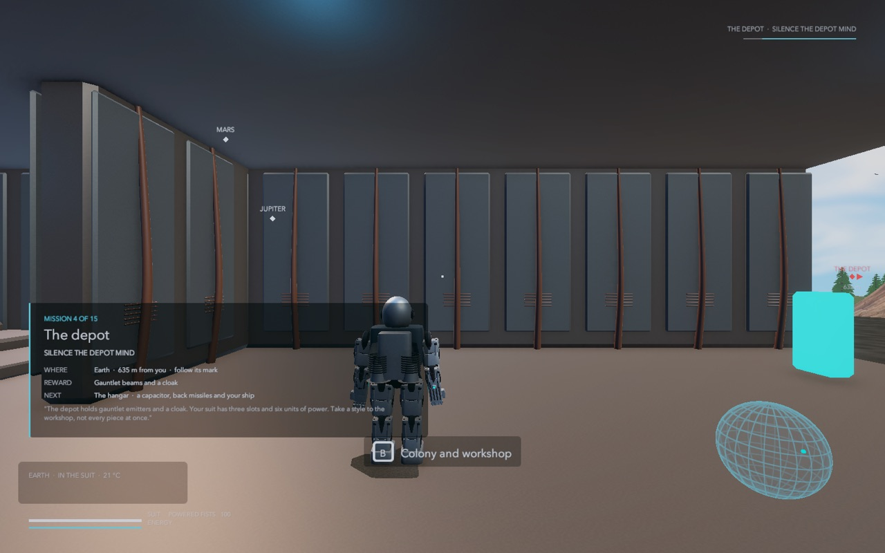 | 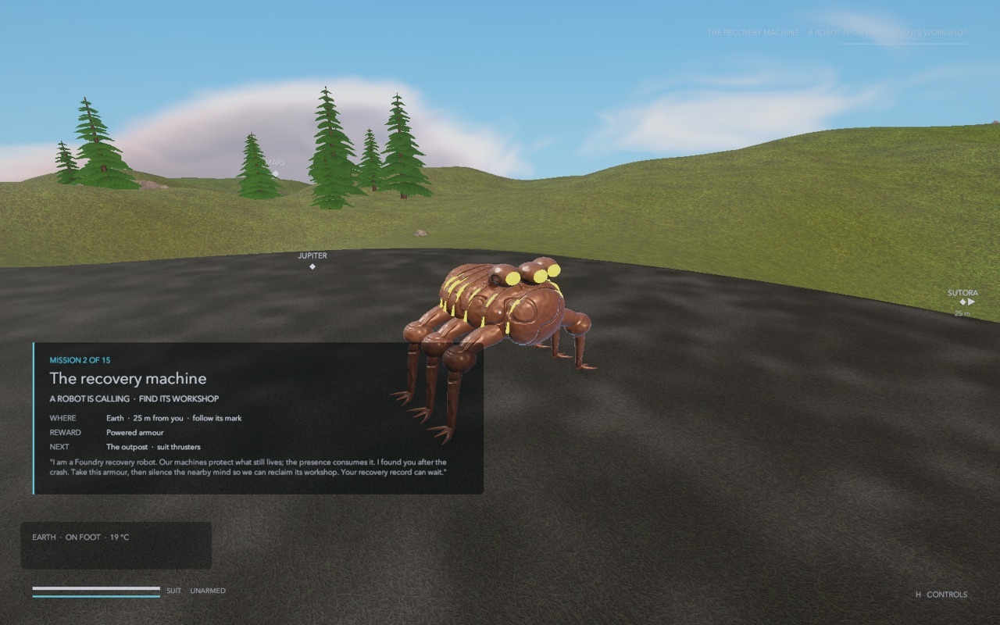 |
| 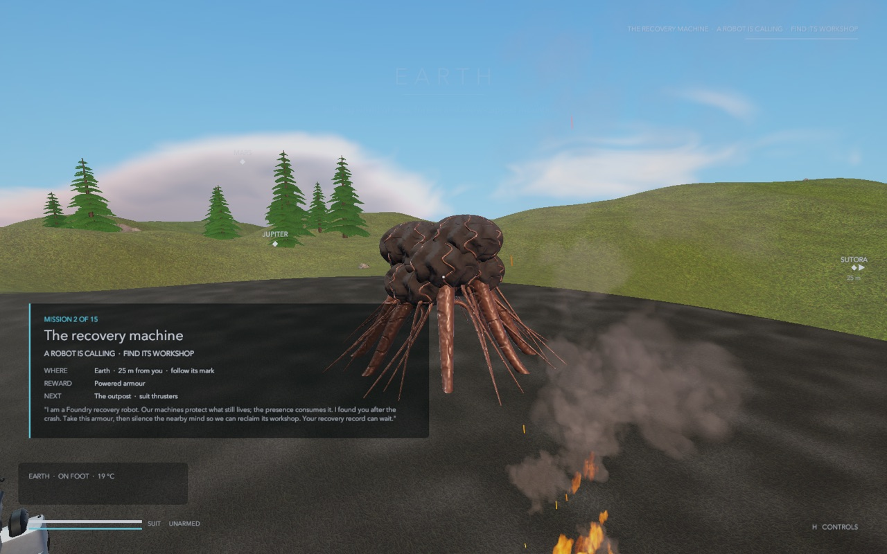 |  |
| 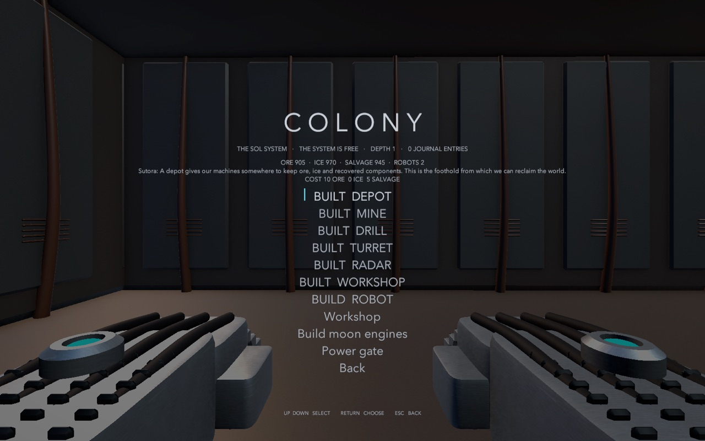 | 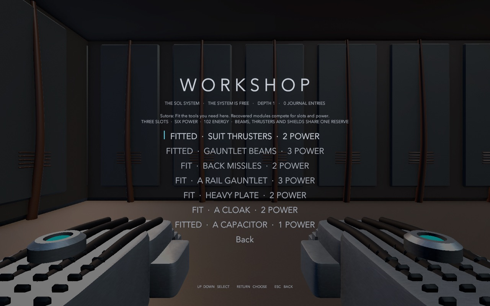 |
|  |  |
| 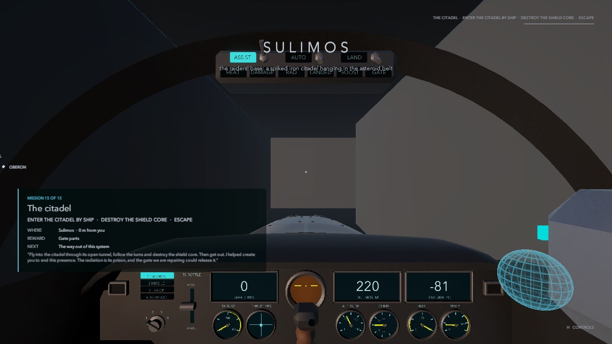 | 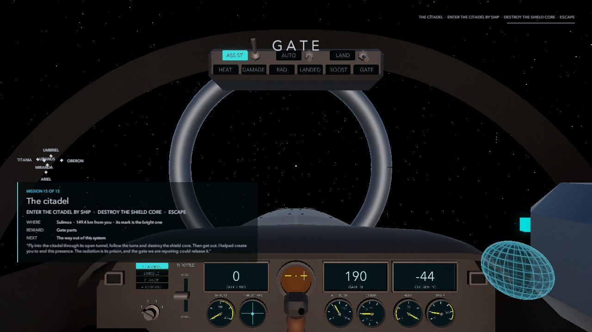 |
|  |  |
|  | 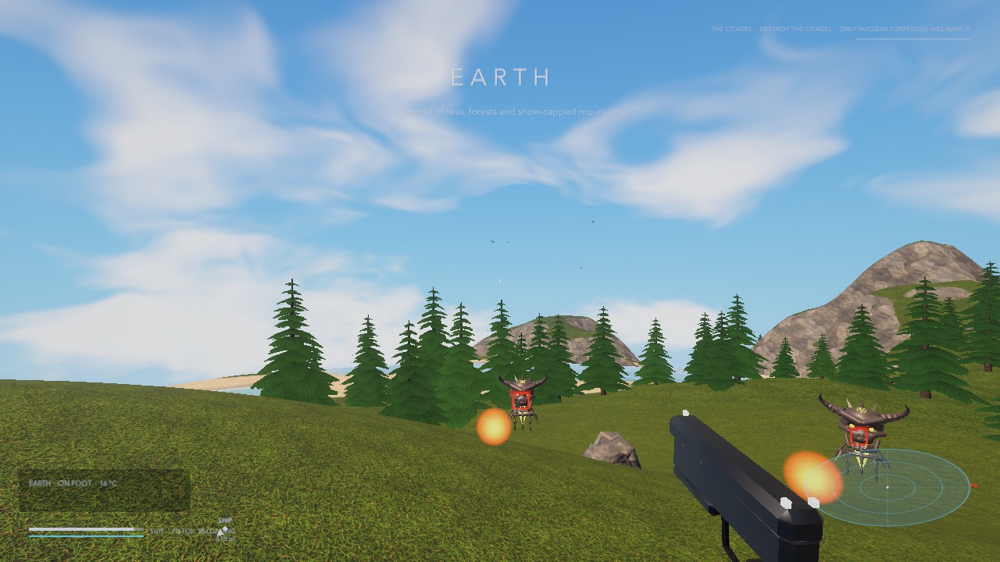 |
|  |  |
| 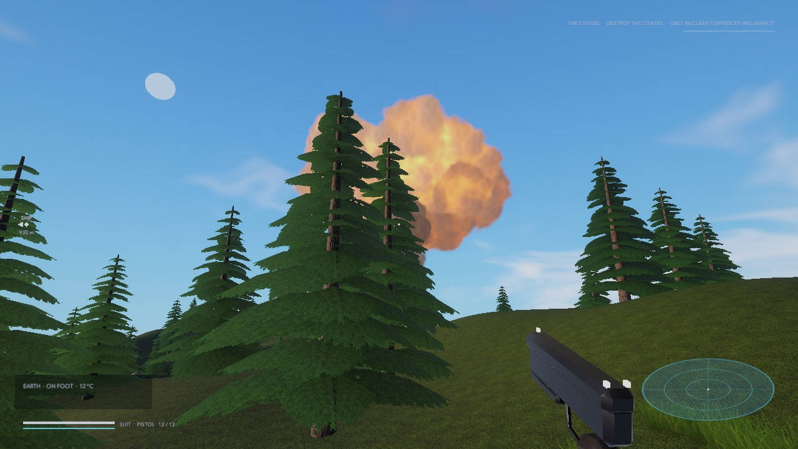 |  |

These are frames from the game, taken by `script/test --unity`.

## Scripts

These follow [scripts to rule them all](https://github.com/github/scripts-to-rule-them-all).

| Script | What it does |
|---|---|
| `script/bootstrap` | Installs Unity Hub, the Unity CLI, Claude Code and OpenAI's `codex` from the `Brewfile`, then the pinned editor version. Only Unity is required: with no model to ask, the scanner reports observed facts and the robot uses authored replies. |
| `script/setup` | Bootstraps, makes sure the current user has a Unity licence and, if they can reach neither Claude nor ChatGPT, signs them in to Claude for the scanner and the robot. See Setup below. |
| `script/editor` | Opens the game in the Unity editor, on the game scene. Press Play. |
| `script/play` | Plays the game as a standalone app, building it first if the project has changed or the last build has no Burst-compiled code. The game's log goes to `Logs/Player.log` and its frame rate to `Logs/frames.log`. |
| `script/build-ios` | Exports `Build/iOS` for signing and running on iPhone or iPad in Xcode. Requires Unity iOS Build Support. |
| `script/build-windows` | Builds `Build/Windows/Infinigame.exe` with OpenXR and the Valve Index controller profile. Requires Windows Build Support. Select SteamVR as the PC's OpenXR runtime. |
| `script/build` | Builds `Build/Infinigame.app` for macOS. Unity's build log goes to `Logs/build.log`. |
| `script/test` | Compiles every assembly and runs the EditMode tests. Needs no Unity licence. |
| `script/test --unity` | Also runs the EditMode and PlayMode tests inside Unity and saves pictures to `Logs/Screenshots`. |
| `script/unity` | Runs the pinned editor against this project with any arguments. |

`script/play`, `script/build` and `script/test --unity` need a licence for whoever runs them and the project closed in the editor.

`Infinigame.app` in the repository root is a link to the latest build, to open from the Finder. Opened that way it does not rebuild itself or write the logs that `script/play` asks for.

`ARCHITECTURE.md` says how the code fits together, `AGENTS.md` what to know before changing it and `IDEAS.md` preserves the expansion brief.

Edit the game's authored content in [STORY.md](STORY.md), [MISSIONS.md](MISSIONS.md), [FACTIONS.md](FACTIONS.md) and [COLONIES.md](COLONIES.md). The editor packages these files when opening the project, entering Play mode or building. [ART.md](ART.md) describes the procedural design process. [LLMS.md](LLMS.md) explains model use and voice options; [PLATFORMS.md](PLATFORMS.md) gives the iPad and SteamVR build steps.

## Setup

Unity licences belong to one operating-system user, so each user who runs Unity needs their own.

1. As your normal user, run `script/setup`. It installs Unity with Homebrew and the Unity CLI. Sign in to Unity Hub when it opens so your account has a licence.
2. As any other user that should run Unity from the command line, such as a sandbox user, run `script/setup` in a terminal. It prints a sign-in URL to open in any browser, including one belonging to your normal user, then activates Unity Personal for that user. Two-factor accounts work because the sign-in happens in the browser.

A licence is tied to a network hardware address that changes now and then. Unity Hub refreshes yours; `script/unity` refreshes one activated by `script/setup` before every launch.

`script/test` on its own needs none of this.

### The scanner and the robot

Their words are written by Claude or by ChatGPT. Which of them, with which model and how much thought, is yours to choose under Settings on the game's menu, where each has a page of its own to sign in from. The game is never built with a key in it and never shows a sign-in form: signing in happens in your browser. It reaches a voice by the first of these that it finds:

1. **A key of your own.** Copy an API key from [platform.claude.com](https://platform.claude.com/settings/keys) or [platform.openai.com](https://platform.openai.com/api-keys) and choose Use the key on the clipboard on that voice's page, or set `ANTHROPIC_API_KEY` or `OPENAI_API_KEY`. The game then asks the maker's API itself, which works on any device, a phone included. Claude Max, Ultra and Team plans [include API credits every month](https://platform.claude.com/docs/en/about-claude/api-credits-for-subscribers), once claimed on claude.ai under Settings, Billing, and so do [ChatGPT Pro and Business plans](https://developers.openai.com/api/docs/guides/chatgpt-api-credits). The key stays on your device, in Keychain on iOS and a local file on desktop, and is never shown.
2. **Continue with ChatGPT.** OpenAI's own [Sign in with ChatGPT](https://developers.openai.com/siwc/token-sharing-open-source): approve in your browser, and what the game asks counts against your ChatGPT Plus or Pro plan. It needs no other tool. Anthropic allows no sign-in to Claude inside other people's apps, so Claude has no such road.
3. **The makers' command-line tools**, on a computer, each with the sign-in it keeps for itself. Every one of them can be told to sign in from its voice's page of the menu:
   - [Claude Code](https://code.claude.com) (Sign in with Claude Code, or `claude auth login`) counts against your Claude plan. The game runs it unmodified, with no tools, for one answer at a time.
   - OpenAI's [`codex`](https://github.com/openai/codex) (Sign in with Codex, or `codex login`) counts against the Codex use that [every ChatGPT plan includes](https://developers.openai.com/codex/pricing).

Each voice's page shows how you stand with it and what the game has asked of it so far: how many times, the tokens in and out and, for Claude by key, about what that cost. While a model is writing, its name and the model's show at the top right of the screen. Put a picture of your own at `Assets/Infinigame/Resources/Icons/Claude.png` or `ChatGPT.png` and it is shown beside the name: the makers' logos are theirs to license, so none ships with the game. Neither maker tells an app what is left of a plan or a balance, so the pages say where to look that up.

Without any of these the game uses authored companion replies and observed scanner facts. Each kind of thing is asked about once per world and then kept in the journal in the save file.

## Play

| Input | On foot | In the ship |
|---|---|---|
| W A S D | run, and with fitted thrusters fly wherever you look | thrust and strafe |
| Mouse | look | steer |
| Space | jump, hold for fitted thrusters, with W to fly forward | lift |
| Ctrl or C | | descend |
| Shift | sprint | boost |
| Q / E | | roll |
| F | talk to the robot, take what an outpost kept, board the ship | land, then leave |
| Click (hold) | fire | fire |
| 1 to 5 or the wheel | fists, gauntlet beam, back missiles or rail gauntlet | pulse cannons, seeker missiles, the lance or nuclear torpedoes |
| R | toggle the fitted cloak | |
| B | colony and workshop, near a depot | |
| Right click | scan what you are looking at | scan the world ahead |
| T | | autopilot to the world you are facing, or a moon near enough to see |
| Z | | flight assist on or off |
| V | first or third person | cockpit or chase view |
| Tab (hold) | the map and the mission: of the world you are on until your ship can cross the system, then of the whole system | |
| Return | talk to the robot, anywhere after the first meeting | |
| G | | cross to the next system while inside the powered gate |
| H | show the list of controls; Escape closes it | |
| M | music on or off | |
| [ and ] | lower or raise detail | |
| - and = | slower or faster mouse look | |
| Option-Return | switch between full screen and a window in the standalone app | |
| Escape | pause menu: resume, controls, settings, cheats, a new game, quit to the title page or quit | |

The game opens on its title page, over the world you last played in: choose one of three save slots to play. Settings, there and on the pause menu, hold how much detail is drawn, music, look speed, full screen, whether the robot is heard as well as read, and who writes for the scanner and the robot. V switches between first person gauntlets and the full articulated suit. Unarmoured, you sink and take drowning damage; armour lets you walk along the seabed and fitted thrusters work underwater. Little else is on screen until there is something to say: where you are and how hot it is there, what is left of your suit or hull, your shared energy reserve and the mission in hand. Other worlds are named in the sky wherever nothing stands in front of them, and from space each shows how far off it is. A rendered radar globe at the bottom right shows foes in every direction, with hollow contacts on its far hemisphere. Foes in view are boxed, with a mark to aim at. Talking to the robot is typing: Return says it and Escape leaves.

`script/play` starts full screen at 60 frames a second, in step with the display. In the editor, set the Game view to Play Maximized.

With flight assist on, the ship hovers, follows the horizon and climbs over terrain. With it off the ship is purely Newtonian and can orbit. The autopilot flies to another world many times faster than you may, steers round anything in the way and stops a short way off. Touching the controls takes the ship back.

Your suit mends itself when left alone and the ship is patched up while it sits on the ground. Rings and the asteroid belt are made of rocks, each on its own orbit: striking one dents the hull, and never finishes it. Blasts and hard landings leave craters in the ground, and what is left depends on what was there: soil and grass are charred black, rock runs molten, glows and creeps downhill as it cools, snow and ice melt into a pool, and a shot into the sea boils it to steam. Mars, Io and Venus have volcanoes you can see from orbit, walk up and land on: Mars a few vast dead shields, Io many small cones with lava in their calderas, Venus broad low ones under its cloud. Coming in to land on ground too rough to sit on, the ship drops a landing charge that blasts a level pad for it first. Heat kills: the star cooks a ship that comes close, a giant cooks one that sinks into it, and an unpowered suit cannot survive furnace heat. The cockpit and the status line show the temperature outside, in red when it is nearly too much. Everything on the ship's dash is live: speed, range, height, climb, hull, heat and thrust on dials and screens, an attitude ball, a stick and throttle that follow your hands, a selector and lamps for the weapons that are fitted, and switches and warning lamps overhead.

Movement is quick: a run is faster than most games' sprint, a jump taken as you land keeps your speed and steering across your path in the air adds to it. Thrusters remain below orbital speed and have an altitude ceiling. Powered fists knock foes back and dig craters; beams damage what they touch while held; missiles home; rail shots pierce successive targets and take time to recharge. The radar is a rendered 3D globe, with contacts all round it and hollow markers on its far side.

Each system has a generated metal song as a fallback. For a compact soundtrack to commit directly, download **MP3** from Suno and put the files in `Assets/Infinigame/Resources/Music`. Use `explore-01.mp3`, `explore-02.mp3` and so on for exploration and `battle-01.mp3` for combat. Other names join the exploration playlist. With no separate battle tracks, the exploration playlist supplies both moods. Unity imports MP3 directly; M4A is not listed among its supported audio-asset formats and would need conversion. See [Unity's audio file compatibility](https://docs.unity.com/en-us/engine/6000.6/manual/audio/files/compatibility).

Tracks stream from disk and play in name order, starting at a seed-selected track. Two audio decks overlap each ending with the next beginning using a five-second crossfade at equal power, shortened for very short clips. Songs need not loop. Unity compresses the imported audio for the target device. MP3 saves repository space, while WAV preserves a lossless source if you want to keep masters separately. Download MP3 directly instead of converting an already compressed M4A. Twenty four-minute tracks at 320 kbps total about 183 MiB, or about 9.2 MiB each; actual size depends on Suno's export bitrate. A mostly final collection of that size is reasonable in normal Git without LFS.

Committing WAVs directly to normal Git is a simple option for a small, mostly final soundtrack. Twenty four-minute WAVs at 44.1 kHz, stereo and 16-bit total about 807 MiB before Git compression, about 40 MiB each. Longer songs and higher bit depths increase that. GitHub warns about individual files above 50 MiB and blocks those above 100 MiB in normal Git. It recommends keeping repositories below 1 GB where possible and strongly recommends staying below 5 GB. See [GitHub's large-file guidance](https://docs.github.com/en/repositories/working-with-files/managing-large-files/about-large-files-on-github). Normal Git does not consume the separate LFS allowance, but ordinary clones carry the audio's retained history, so replacing songs repeatedly makes the repository larger even after deleting old working copies.

Git LFS is preferable for frequently revised large audio and is required to track files above GitHub's normal per-file limit. For the same 807 MiB soundtrack, it uses 7.9% of GitHub Free's 10 GiB storage and permits twelve full soundtrack downloads within its separate 10 GiB monthly bandwidth allowance. Each changed binary adds its full size to LFS storage. With those assumptions, thirteen complete soundtrack versions exceed 10 GiB: replacing every song weekly reaches that point twelve weeks after the first upload. Replacing one song weekly takes about 234 weeks. Fresh clones and CI downloads consume LFS bandwidth, while uploads, local play and local rebuilds do not. See [GitHub's LFS billing rules](https://docs.github.com/en/billing/concepts/product-billing/git-lfs). Actual totals depend on the exported files and any other LFS repositories on the account.

The six supplied MP3 songs total **45.46 MiB** and are committed in normal Git, with their Unity metadata. They use **none of the Git LFS allowance**. At the same average size, twenty songs would occupy about 152 MiB per complete version. No LFS tracking is configured. If future larger files need LFS, configure tracking before adding those files; keep Unity `.meta` files in normal Git.

### The missions and colony

The early missions recover the suit, thrusters, beams, cloak, capacitor, shoulder missiles and ship. The tower holds the orbital drive and Luna the ship's radiation shield. The outer missions recover ship weapons, plating, a hull mender, the rail gauntlet and heavier armour. The citadel holds the gate parts and the shield core protecting the final mind.

A red marker leads to the current outpost. Enter its rooms and silence the mind, then take the prize with F. Powered weapons can breach walls from inside the shield; cleared buildings and breaches remain after mission completion and reload. A terminal can open the door and turn sentries against their own mind. Quiet movement and a fitted cloak reduce detection. Return opens the robot's radio after the first meeting, including on foot.

A liberated world's first depot starts with one robot and a small stock of materials. Return to it and press B to deposit what you have collected, build or open its workshop. Mines produce ore and drills produce ice. Moons are labelled only when close enough to resolve. Radar reduces raid pressure by 35%; it does not expose remote moons. Turrets consume ore to repel raids and recover salvage; an undefended raid costs robots. Workshops automatically spend available supplies on another worker every two minutes, up to 32. Defended colonies suppress enemy spread and protect local life. A workshop and four robots can build moon engines after the citadel falls. Powering the gate requires the final mind destroyed, eight robots across the colonies and the listed resources. Costs and stocks are shown before building.

The pause menu's cheats can skip missions, grant recovered equipment or cross to a new generated system. Each save slot keeps its own equipment, fitted modules, colony stocks, spreading presence, moonfall and gate state. Dying restarts the mission in hand.

### Other devices

Touch controls use the lower part of the display for actions, with movement on the left and looking on the right. The Mobile detail tier is selected on iPhone and iPad. Accounts are held in the iOS Keychain. Dialogue is text on iOS and Windows; macOS keeps its existing local speech, with no paid speech service.

On a Windows PC, the OpenXR path uses tracked controllers and a seated cockpit, with slower walking and snap turns for comfort. The HUD is a panel in the world. The left stick moves and the right stick snap-turns. Clicking the left stick opens the pause menu. Right trigger fires and right grip interacts. Left grip modifies the controls: trigger scans, left A opens the radio, left B opens the colony, right B toggles the cloak and right stick click crosses the gate. Without the modifier, right B changes weapon, left B holds the map and right stick click starts autopilot. In dialogue, right A, left A and right grip ask the three displayed questions. Device builds and comfort still need testing on the intended iPhone, iPad and Valve Index; a macOS test run cannot establish that they work well on those devices.

### The system

The worlds carry the names of the ones they copy, from Sol and Mercury out to Neptune and Triton, and the planets, their bigger moons and their rings keep their real sizes relative to each other. The star does not, as to scale it would fill the sky, and the home moon is a little small so that it can be walked round in five minutes. Distances are far too short to be to scale, and so is the year. The home world turns once in about ten minutes and goes round its star in twelve of those days, about two hours, so that planets can be seen to move and seasons to turn while you play. Every other year is the real one counted in home years, and days and months are the real ones counted in home days. The two worlds nearest the star are the exception, as their slow spins are tied to their orbits: the scorched rock turns three times in two of its years, and the furnace world turns backwards more slowly than it circles the sun. The moon goes round in 27 days and rocks from side to side as it goes, and one ice giant lies on its side. Orbits are ellipses, swept faster near the star, each in a plane of its own, and every world leans on its real axial tilt. Moons circle over their planet's equator, in the plane of its rings, except the home moon, which keeps near the plane of the planets as ours does.

Storms wander the home world and it rains under them; at night its poles glow. The other worlds are a scorched rock, a furnace under unbroken cloud, a rust desert with polar ice and blue sunsets, and four giants with nothing to land on but their moons. Hold Tab for the map and a table of every world: size, gravity, warmth, day, year, tilt and moons.

