# Infinigame

A procedural solar system to explore in powered armour and by ship. The first system is a tiny copy of our own, with spherical worlds, seas, forests, weather and strange life. Beyond its singularity are generated systems with their own worlds, living moons and sometimes two stars. Scan anything and Claude or ChatGPT writes its journal entry.

You wake buried in sealed armour. The screen starts black: your suit restores its neural link, visor and emergency actuators. “You are not dead. You are not dead. Fight.” Punch through the wreckage with crackling fists. The reactor is critical, leaving thrusters and other weapons offline. A recovery robot waits beside the hole.

Earth is occupied by roaming alien bodies. Your first target is a mind in a descending burrow defended only by basic stalkers. Kill it and collect its power core for powered fists and a basic hand beam. Two more regional burrows, with two and three linked minds, unlock surface thrusters and then orbital flight. Later worlds supply missiles, rail weapons and hemisphere lasers. Later burrows introduce breachers and spitters. There are no hacking terminals. Alien impacts shed purple fluid and tissue, leaving stained bodies, ground and armour.

After the second burrow, clear enough bodies to build a robodog factory with B. Each Earth region needs a separate factory. Its laser-armed quadrupeds replicate and hunt until that region’s aliens are gone. After all three regional factories conquer Earth, upgrade one to a shipyard. Robot ships contest the living fleet. Factories support only their own planetary neighbourhood and one adjacent planet; new fronts need your intervention. Without help, alien growth can overwhelm a young factory. Whole-world populations are simulated, with bounded numbers of active units nearby.

Jetpack just beyond the atmosphere to recover your unmanned ship. Once you reach orbit it detects your suit and approaches at a safe relative speed. After recovery, T also recalls it on the ground or in space. It has pulse blasters, missiles, beams, a railgun and ultimately nuclear torpedoes. Your companion rides behind the pilot with its head above the socket and answers the radio anywhere. Later planets and systems have more enemies and faster growth.

The ending begins with the citadel's shield core. Navigate its winding corridors, destroy the core and escape before the 25-second alarm ends. After your shipyard clears local space, build moon engines. Your ship follows the accelerating moon. The impact collapses the buried final mind into a black hole. Worlds and then the sun spiral in; the view goes white and you emerge in a harder generated system. The next system's descriptor and mission sites are generated in the background during the destruction.

Built with Unity 6.6 (6000.6.9f1) and URP. Everything is generated from code: terrain, models, textures, materials, the interface, sound effects and music. Official Unity packages provide engine and platform support; there are no downloaded art assets, though you can drop in music of your own.

The texture and model generators, shaders, material settings and Unity metadata belong in Git. Surface colour, height and normal maps are generated in memory, so there are no exported texture copies to commit. The application icon and the small documentation pictures below also stay in normal Git. Build output, Unity's cache and test captures stay ignored.

| | |
|---|---|
| 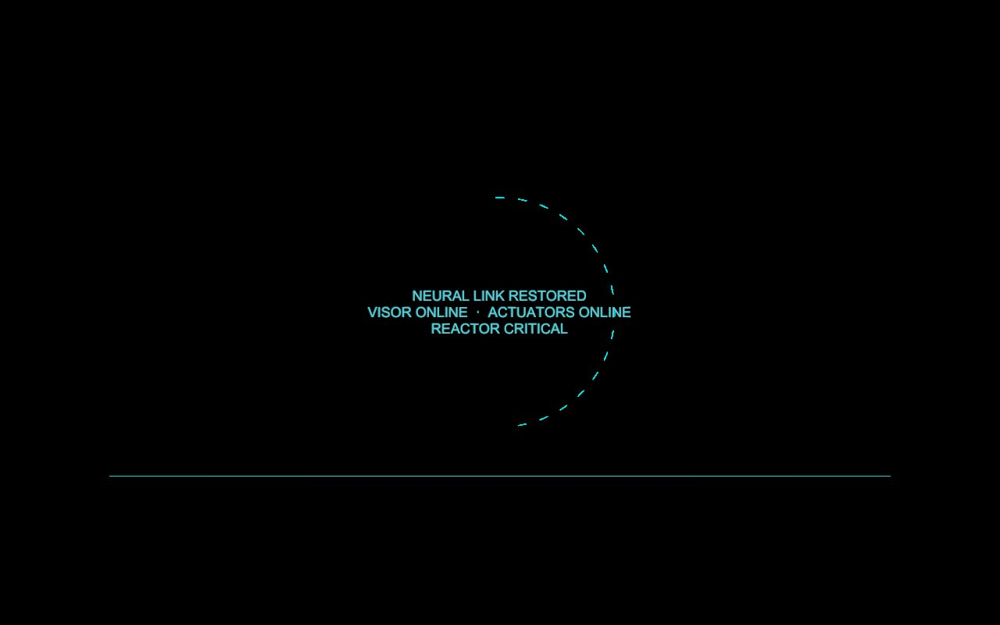 | 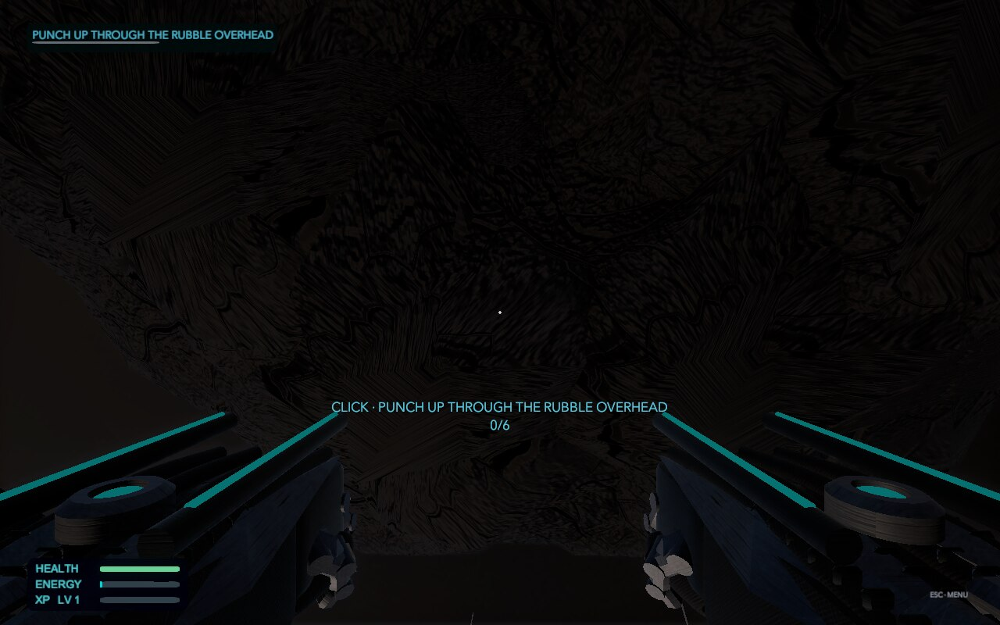 |
|  | 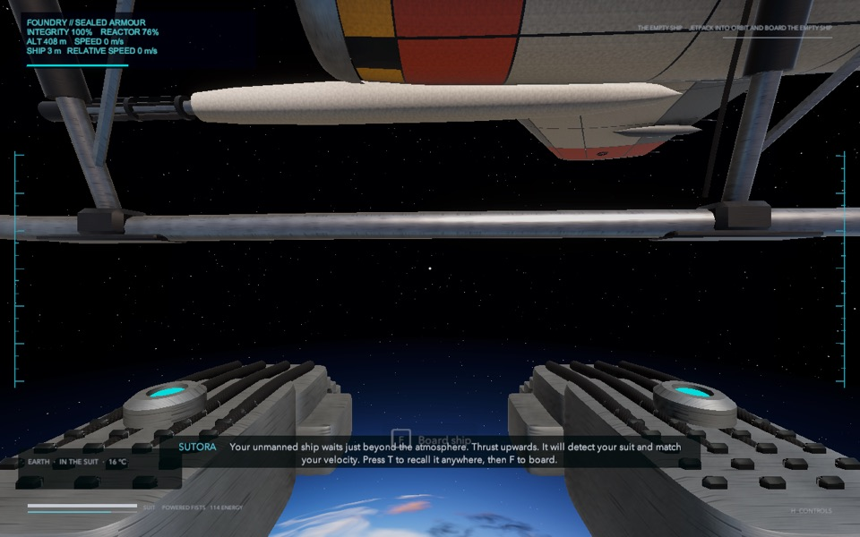 |
| 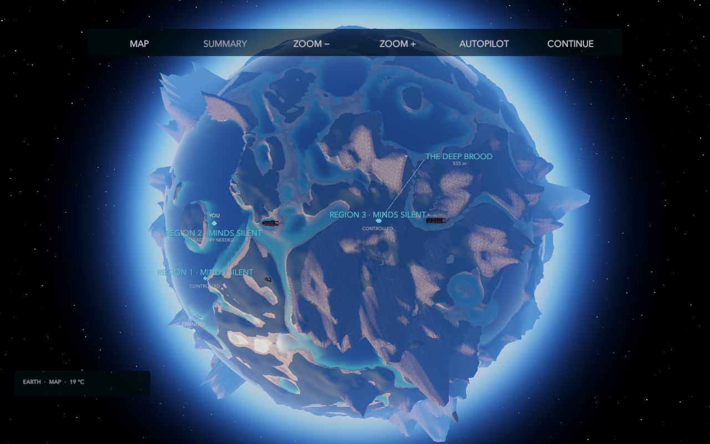 | 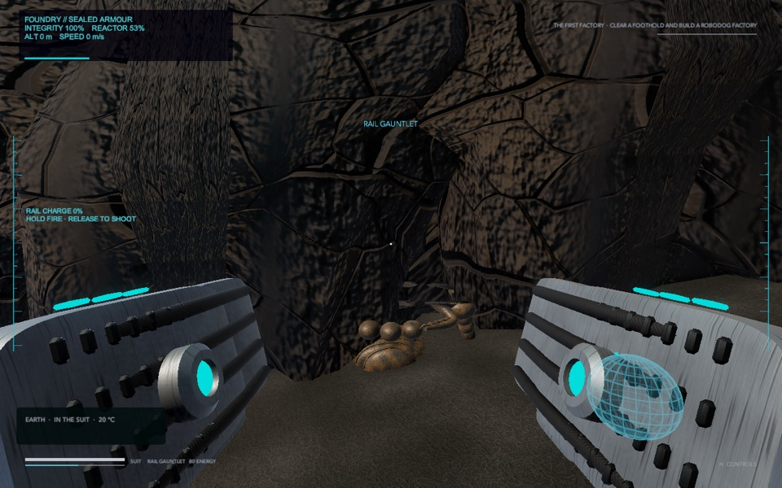 |
| 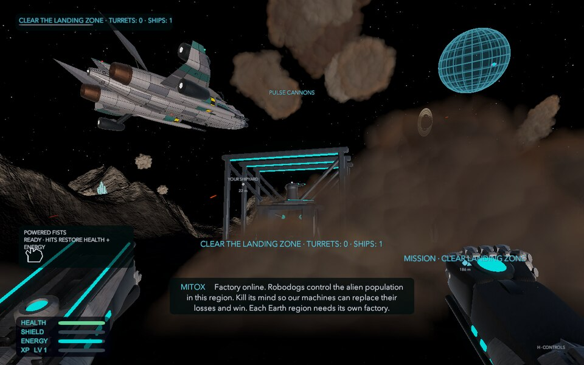 | 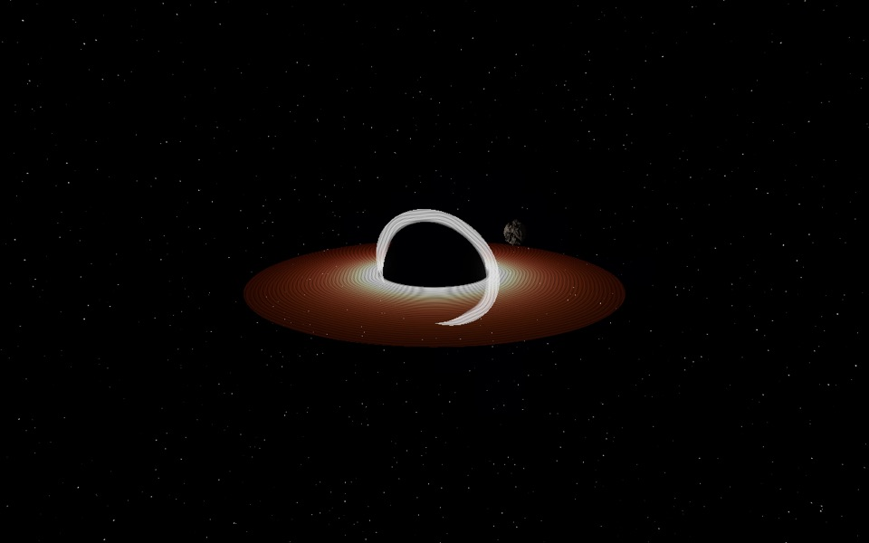 |
|  |  |
|  | 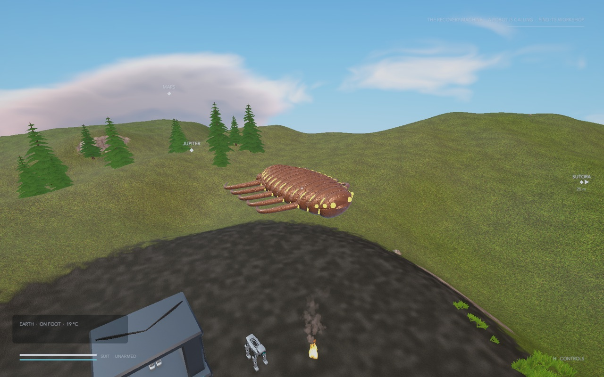 |
| 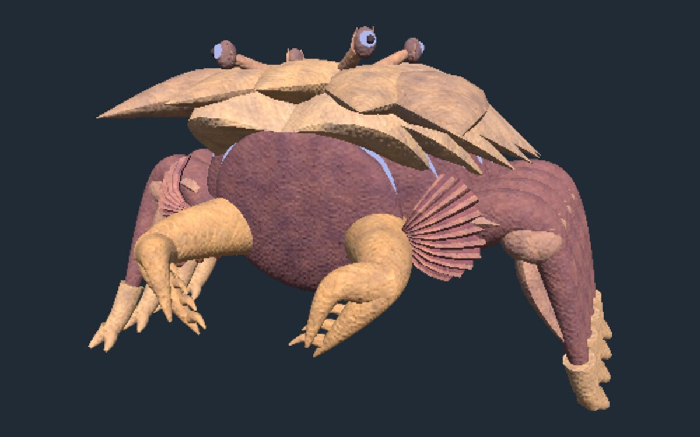 | 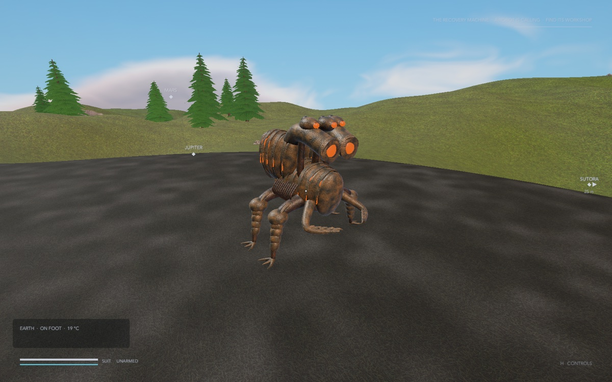 |
| 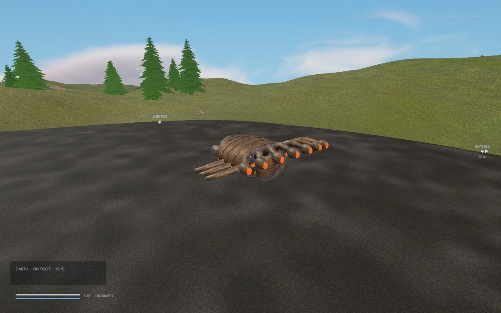 | 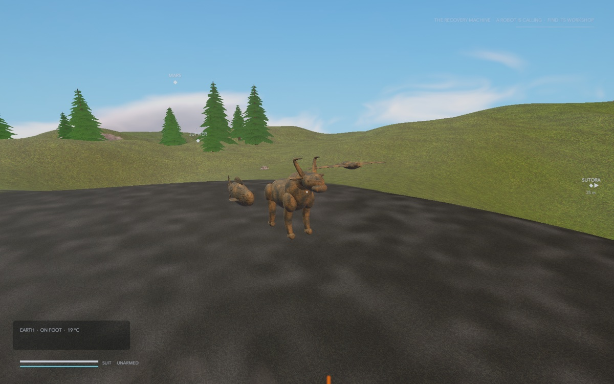 |
|  |  |
|  | 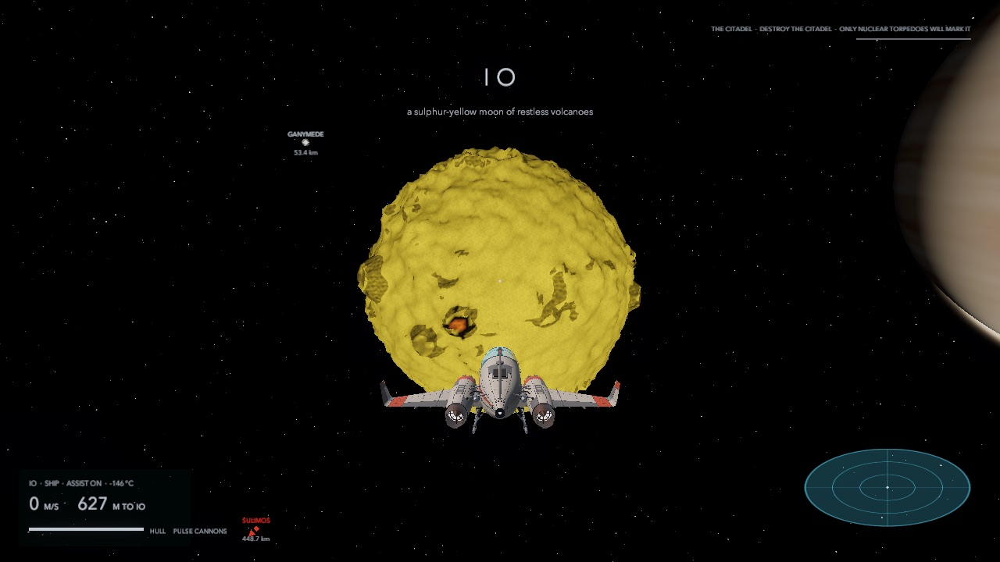 |

These are frames from the game, taken by `script/test --unity`.

## Scripts

These follow [scripts to rule them all](https://github.com/github/scripts-to-rule-them-all).

| Script | What it does |
|---|---|
| `script/bootstrap` | Installs Unity Hub, the Unity CLI, Claude Code and OpenAI's `codex` from the `Brewfile`, then the pinned editor version. Only Unity is required: with no model to ask, the scanner reports observed facts and the robot uses authored replies. |
| `script/setup` | Bootstraps, makes sure the current user has a Unity licence and, if they can reach neither Claude nor ChatGPT, signs them in to Claude for the scanner and the robot. See Setup below. |
| `script/editor` | Opens the game in the Unity editor, on the game scene. Press Play. |
| `script/play` | Plays the game as a standalone app, building it first if the project has changed or the last build has no Burst-compiled code. The game's log goes to `Logs/Player.log` and its frame rate to `Logs/frames.log`. |
| `script/build-ios` | Exports `Build/iOS`, then compiles and links the device app with Xcode. Reuses the existing signing team and prints installation steps. |
| `script/build-windows` | Builds `Build/Windows/Infinigame.exe` with OpenXR and packages `Build/Infinigame-Windows.zip`, with installation steps. |
| `script/build-steam-deck` | Packages a desktop build without automatic XR as `Build/Infinigame-SteamDeck.zip`, with Proton installation steps. |
| `script/performance` | Reports the latest real Mac play session from `Logs/frames.log`, excluding menus. |
| `script/build` | Builds `Build/Infinigame.app` for macOS. Unity's build log goes to `Logs/build.log`. |
| `script/test` | Compiles every assembly and runs the EditMode tests. Needs no Unity licence. |
| `script/test --unity` | Also runs the EditMode and PlayMode tests inside Unity and saves pictures to `Logs/Screenshots`. |
| `script/unity` | Runs the pinned editor against this project with any arguments. |

`script/play`, `script/build` and `script/test --unity` need a licence for whoever runs them and the project closed in the editor.

`Infinigame.app` in the repository root is a link to the latest build, to open from the Finder. Opened that way it does not rebuild itself or write the logs that `script/play` asks for.

`ARCHITECTURE.md` says how the code fits together, `AGENTS.md` what to know before changing it and `IDEAS.md` preserves the expansion brief.

Edit the game's authored content in [STORY.md](STORY.md), [MISSIONS.md](MISSIONS.md), [FACTIONS.md](FACTIONS.md) and [COLONIES.md](COLONIES.md). The editor packages these files when opening the project, entering Play mode or building. [ART.md](ART.md) describes the procedural design process. [LLMS.md](LLMS.md) explains model use and voice options; [PLATFORMS.md](PLATFORMS.md) gives the iPhone, iPad, SteamVR and Steam Deck build and installation steps.

## Setup

Unity licences belong to one operating-system user, so each user who runs Unity needs their own.

1. As your normal user, run `script/setup`. It installs Unity with Homebrew and the Unity CLI. Sign in to Unity Hub when it opens so your account has a licence.
2. As any other user that should run Unity from the command line, such as a sandbox user, run `script/setup` in a terminal. It prints a sign-in URL to open in any browser, including one belonging to your normal user, then activates Unity Personal for that user. Two-factor accounts work because the sign-in happens in the browser.

A licence is tied to a network hardware address that changes now and then. Unity Hub refreshes yours; `script/unity` refreshes one activated by `script/setup` before every launch.

`script/test` on its own needs none of this.

### The scanner and the robot

Their words are written by Claude or by ChatGPT. Which of them, with which model and how much thought, is yours to choose under Settings on the game's menu, where each has a page of its own to sign in from. The game is never built with a key in it and never shows a sign-in form: signing in happens in your browser. It reaches a voice by the first of these that it finds:

1. **A key of your own.** Copy an API key from [platform.claude.com](https://platform.claude.com/settings/keys) or [platform.openai.com](https://platform.openai.com/api-keys) and choose Use the key on the clipboard on that voice's page, or set `ANTHROPIC_API_KEY` or `OPENAI_API_KEY`. The game then asks the maker's API itself, which works on any device, a phone included. Claude Max, Ultra and Team plans [include API credits every month](https://platform.claude.com/docs/en/about-claude/api-credits-for-subscribers), once claimed on claude.ai under Settings, Billing, and so do [ChatGPT Pro and Business plans](https://developers.openai.com/api/docs/guides/chatgpt-api-credits). The key stays on your device, in Keychain on iOS and a local file on desktop, and is never shown.
2. **Continue with ChatGPT.** OpenAI's own [Sign in with ChatGPT](https://developers.openai.com/siwc/token-sharing-open-source): approve in your browser, and what the game asks counts against your ChatGPT Plus or Pro plan. It needs no other tool. Anthropic allows no sign-in to Claude inside other people's apps, so Claude has no such road.
3. **The makers' command-line tools**, on a computer, each with the sign-in it keeps for itself. Every one of them can be told to sign in from its voice's page of the menu:
   - [Claude Code](https://code.claude.com) (Sign in with Claude Code, or `claude auth login`) counts against your Claude plan. The game runs it unmodified, with no tools, for one answer at a time.
   - OpenAI's [`codex`](https://github.com/openai/codex) (Sign in with Codex, or `codex login`) counts against the Codex use that [every ChatGPT plan includes](https://developers.openai.com/codex/pricing).

Each voice's page shows how you stand with it and what the game has asked of it so far: how many times, the tokens in and out and, for Claude by key, about what that cost. While a model is writing, its name and the model's show at the top right of the screen. Put a picture of your own at `Assets/Infinigame/Resources/Icons/Claude.png` or `ChatGPT.png` and it is shown beside the name: the makers' logos are theirs to license, so none ships with the game. Neither maker tells an app what is left of a plan or a balance, so the pages say where to look that up.

Without any of these the game uses authored companion replies and observed scanner facts. Each kind of thing is asked about once per world and then kept in the journal in the save file.

## Play

| Input | On foot | In the ship |
|---|---|---|
| W A S D | run, and with fitted thrusters fly wherever you look | thrust and strafe |
| Mouse | look | steer |
| Space | jump, hold for fitted thrusters, with W to fly forward | lift |
| Ctrl or C | | descend |
| Shift | sprint | boost |
| Q / E | | roll |
| F | talk to the robot, take what an outpost kept, board the ship | land, then leave |
| Click (hold) | fire | fire |
| 1 to 5 or the wheel | fists, hand beam, shoulder missiles, rail or hemisphere lasers | pulse blasters, missiles, beam, railgun or nuclear torpedoes |
| R | toggle the fitted cloak | |
| B | factory uplink | |
| X | scan what you are looking at | scan the world ahead |
| T | recall the ship to land or pick you up | autopilot to the world ahead; on Tab, travel to the selected destination |
| Z | | flight assist on or off |
| V | first or third person | cockpit or chase view |
| Tab (toggle) | the map and the mission: of the world you are on until your ship can cross the system, then of the whole system | |
| Return | talk to the robot, anywhere after the first meeting | |
| Y (hold) | speak to the companion; release to send | speak to the companion |
| H | show the list of controls; Escape closes it | |
| M | music on or off | |
| [ and ] | lower or raise detail | |
| - and = | slower or faster mouse look | |
| Option-Return | switch between full screen and a window in the standalone app | |
| Escape | pause menu: resume, controls, settings, a confirmed new game, quit to the title page or quit | |

The game opens on its title page, over the world you last played in: choose one of three save slots to play. Settings, there and on the pause menu, hold how much detail is drawn, music, look speed, full screen, whether the robot is heard as well as read, and who writes for the scanner and the robot. V switches between first person gauntlets and the full articulated suit. The sealed suit walks along the seabed; restored thrusters work underwater. Helmet instrumentation shows where you are and how hot it is there, what is left of your suit or hull, your shared energy reserve and the mission in hand. World markers appear outside the atmosphere, with nearby moons revealed as you approach. A rendered radar globe at the bottom right shows foes in every direction, with hollow contacts on its far hemisphere. Nearby foes are highlighted after full suit power is restored. Talking to the robot is typing: Return says it and Escape leaves.

`script/play` starts full screen with a fixed 60 FPS target. Settings > Automatic quality adjusts terrain detail and resolution from measured frame timings; switch it off to keep the selected preset. In the editor, set the Game view to Play Maximized.

With flight assist on, the ship hovers, follows the horizon and climbs over terrain. With it off the ship is purely Newtonian and can orbit. The autopilot flies to another world many times faster than you may, steers round anything in the way and stops a short way off. Touching the controls takes the ship back.

Your suit mends itself when left alone and the ship is patched up while it sits on the ground. Rings and the asteroid belt are made of rocks, each on its own orbit: striking one dents the hull, and never finishes it. Blasts and hard landings leave craters in the ground, and what is left depends on what was there: soil and grass are charred black, rock runs molten, glows and creeps downhill as it cools, snow and ice melt into a pool, and a shot into the sea boils it to steam. Mars, Io and Venus have volcanoes you can see from orbit, walk up and land on: Mars a few vast dead shields, Io many small cones with lava in their calderas, Venus broad low ones under its cloud. Coming in to land on ground too rough to sit on, the ship drops a landing charge that blasts a level pad for it first. Heat kills: the star cooks a ship that comes close, a giant cooks one that sinks into it, and an unpowered suit cannot survive furnace heat. The cockpit and the status line show the temperature outside, in red when it is nearly too much. Everything on the ship's dash is live: speed, range, height, climb, hull, heat and thrust on dials and screens, an attitude ball, a stick and throttle that follow your hands, a selector and lamps for the weapons that are fitted, and switches and warning lamps overhead.

Movement is quick: a run is faster than most games' sprint, a jump taken as you land keeps your speed and steering across your path in the air adds to it. Restored thrusters can climb to the ship in low orbit. Powered fists knock foes back and dig craters; beams damage what they touch while held; suit missiles seek spacecraft and rooted turrets and reload every 3.4 seconds; the rail gauntlet charges while held and fires on release, piercing successive targets. The suit railgun charges in 0.55 seconds and the ship railgun in 0.95 seconds and fire on release; touch Fire automatically charges and releases them from one tap, with mild aim assistance. The ship fires twin sniper rails or missiles. The rendered globe radar always shows nearby enemies, with violet elongated contacts for aircraft and orange contacts for ground units.

Each system has a generated metal song as a fallback. For a compact soundtrack to commit directly, download **MP3** from Suno and put the files in `Assets/Infinigame/Resources/Music`. Use `explore-01.mp3`, `explore-02.mp3` and so on for exploration and `battle-01.mp3` for combat. Other names join the exploration playlist. With no separate battle tracks, the exploration playlist supplies both moods. Unity imports MP3 directly; M4A is not listed among its supported audio-asset formats and would need conversion. See [Unity's audio file compatibility](https://docs.unity.com/en-us/engine/6000.6/manual/audio/files/compatibility).

Tracks stream from disk and play in name order, starting at a seed-selected track. Two audio decks overlap each ending with the next beginning using a five-second crossfade at equal power, shortened for very short clips. Songs need not loop. Unity compresses the imported audio for the target device. MP3 saves repository space, while WAV preserves a lossless source if you want to keep masters separately. Download MP3 directly instead of converting an already compressed M4A. Twenty four-minute tracks at 320 kbps total about 183 MiB, or about 9.2 MiB each; actual size depends on Suno's export bitrate. A mostly final collection of that size is reasonable in normal Git without LFS.

Committing WAVs directly to normal Git is a simple option for a small, mostly final soundtrack. Twenty four-minute WAVs at 44.1 kHz, stereo and 16-bit total about 807 MiB before Git compression, about 40 MiB each. Longer songs and higher bit depths increase that. GitHub warns about individual files above 50 MiB and blocks those above 100 MiB in normal Git. It recommends keeping repositories below 1 GB where possible and strongly recommends staying below 5 GB. See [GitHub's large-file guidance](https://docs.github.com/en/repositories/working-with-files/managing-large-files/about-large-files-on-github). Normal Git does not consume the separate LFS allowance, but ordinary clones carry the audio's retained history, so replacing songs repeatedly makes the repository larger even after deleting old working copies.

Git LFS is preferable for frequently revised large audio and is required to track files above GitHub's normal per-file limit. For the same 807 MiB soundtrack, it uses 7.9% of GitHub Free's 10 GiB storage and permits twelve full soundtrack downloads within its separate 10 GiB monthly bandwidth allowance. Each changed binary adds its full size to LFS storage. With those assumptions, thirteen complete soundtrack versions exceed 10 GiB: replacing every song weekly reaches that point twelve weeks after the first upload. Replacing one song weekly takes about 234 weeks. Fresh clones and CI downloads consume LFS bandwidth, while uploads, local play and local rebuilds do not. See [GitHub's LFS billing rules](https://docs.github.com/en/billing/concepts/product-billing/git-lfs). Actual totals depend on the exported files and any other LFS repositories on the account.

The six supplied MP3 songs total **45.46 MiB** and are committed in normal Git, with their Unity metadata. They use **none of the Git LFS allowance**. At the same average size, twenty songs would occupy about 152 MiB per complete version. No LFS tracking is configured. If future larger files need LFS, configure tracking before adding those files; keep Unity `.meta` files in normal Git.

### The missions and factories

The first burrow and recovery companion are within walking distance. Killing its mind does not restore power until you collect the core. The first core restores powered fists and the hand beam. Further burrows and worlds unlock the remaining weapons, which share an energy reserve. First- and third-person views work on foot. Press B on foot to view factory prerequisites and place a factory on a level pad ahead of you. There are no separate mines, drills, turrets, radar buildings or workshops to build.

Leave the burrow before placing a factory or climbing to the ship. A factory needs a combat foothold: four kills on the first world, increasing with world difficulty and system depth. The player alone cannot reduce a planet's population below one; the factory's robodogs finish the war. Shipyards upgrade an existing factory only after ground victory. Production stops when the relevant enemy population is eliminated. Colonies do not advance while the game is closed. A shipyard that has cleared its local hostile fleet can build moon engines once the citadel core is destroyed. No gate repair or powering step remains.

Return opens the companion's typed radio. Hold Y to speak and release to send; mobile builds have a held Mic button. The game sends a bounded JSON state snapshot and only three recent exchanges. Scan aliens, robots, factories, spacecraft, wildlife or worlds with X, the touch Scan action or the controller binding in Controls. Without an LLM, authored companion guidance and observed scanner facts remain available.

Three save slots retain equipment, missions, factories, war populations and the ending state. Death restarts the current mission. Older equipment bits remain stable; the redesigned opening is best experienced in a new slot.

### Other devices

Touch controls have a large Fire button, Lift and contextual Use, with secondary actions behind ···. Recall appears there once the ship link is available; locked equipment actions stay hidden. Use the separate visible Move and Look joysticks; iPad hardware keyboards work alongside touch. The Mobile detail tier is selected on iPhone and iPad. Accounts are held in the iOS Keychain. Companion output uses free local system voices on macOS, Windows and iOS, with independent subtitle and voice settings. Steam Deck uses text when speech services are unavailable under Proton. Voice input uses local Apple dictation when available or the Windows speech recogniser. No paid speech service is enabled.

On a Windows PC, the OpenXR path uses tracked controllers and a seated cockpit, with slower walking and snap turns for comfort. The suit HUD follows your view; in the ship it stays on the cockpit. The left wrist carries a touchable control screen. The left stick moves in the direction you look and the right stick snap-turns. Hold left A to jump or use restored thrusters and right A to descend. Clicking the left stick opens the pause menu. Move a tracked hand to punch; right trigger fires other weapons and right grip interacts. Left grip modifies the controls: trigger scans, left A opens the radio, left B opens the factory uplink, right B toggles the cloak and right stick click starts or finishes voice input. Without the modifier, right B changes weapon, left B toggles the map and right stick click starts autopilot. In dialogue, right A, left A and right grip ask the three displayed questions. Device builds and comfort still need testing on the intended iPhone, iPad and Valve Index; a macOS test run cannot establish that they work well on those devices.

### The system

The worlds carry the names of the ones they copy, from Sol and Mercury out to Neptune and Triton, and the planets, their bigger moons and their rings keep their real sizes relative to each other. The star does not, as to scale it would fill the sky, and the home moon is a little small so that it can be walked round in five minutes. Distances are far too short to be to scale, and so is the year. The home world turns once in about ten minutes and goes round its star in twelve of those days, about two hours, so that planets can be seen to move and seasons to turn while you play. Every other year is the real one counted in home years, and days and months are the real ones counted in home days. The two worlds nearest the star are the exception, as their slow spins are tied to their orbits: the scorched rock turns three times in two of its years, and the furnace world turns backwards more slowly than it circles the sun. The moon goes round in 27 days and rocks from side to side as it goes, and one ice giant lies on its side. Orbits are ellipses, swept faster near the star, each in a plane of its own, and every world leans on its real axial tilt. Moons circle over their planet's equator, in the plane of its rings, except the home moon, which keeps near the plane of the planets as ours does.

Storms wander the home world and it rains under them; at night its poles glow. The other worlds are a scorched rock, a furnace under unbroken cloud, a rust desert with polar ice and blue sunsets, and four giants with nothing to land on but their moons. Press Tab for the paused war map: populations, factory status, conquest and travel destinations.

## Visor, saves and cheats

Tab opens a paused war map with alien, robodog and fleet populations, foothold kill counts and factory status. Use Up/Down to select a destination and T to set autopilot, then press Tab again to depart. Controls also pause the game. Surface enemy health bars appear at close range, with wider detection after suit power is restored; orbital markers stay off the surface HUD.

The title screen offers Delete slot actions with confirmation. New game also asks before replacing a slot. Type `idgaf` on the title or pause menu, or click its small ◇ icon, to toggle Cheats. Repeating either action hides Cheats and switches off invulnerability. Its mission picker can move forwards or backwards through the thirteen stages; **Moon engines built · replay finale** starts the full ending immediately and can restart it.

HDR output activates on a supported display, using detected brightness with SDR fallback. See [PERFORMANCE.md](PERFORMANCE.md) for measured Mac performance and how to collect the next comparison. The suit rail gauntlet requires hold/release; VR fists require moving a tracked hand. First-person legs and torso stay visible, with independent VR hands. Bodies remain as articulated, breakable wrecks within a bounded memory budget.

The first recovery is a narrated tutorial: punch through rubble with the view locked, listen to the nearby robot, restore looking and walking, then punch one basic fighter. The first burrow entrance has a precise punch marker. Its shielded battery remains visible; collecting equipment after each mind kill arms a 20-second demolition. Run clear before the whole burrow is destroyed.

Factories can be seeded before killing a mind, but those robodogs are weak. Silencing the mind unlocks their strength: even an empty factory rebuilds and eventually conquers the world. Only one robodog emerges immediately, with later units following from the assembly lift into expanding patrols. Factory locations stay marked. Their rotating roof weapons cycle through the suit's weapon types.

The cartoon app icon is generated by `Infinigame.Editor.AppIcon.Generate` and shared by Mac, Windows and Apple mobile builds. `script/build` removes an old protected generated plist without asking an interactive overwrite question. Build distribution and Steam Deck's intentional Win64/Proton route are explained in [PLATFORMS.md](PLATFORMS.md).

## Combat and interface refinements

Tab toggles the paused map. Use **Map / Summary** to switch between the zoomable view and the planet/mission table. The zoom buttons or mouse wheel change scale; V switches pages. Choose a destination in Summary and select Autopilot, then close the map to depart. The robot dialogue has a Close action; Escape or clicking outside closes it without opening the pause menu.

A weapon outline and name appear on the left of the visor. Hold and release either rail weapon to charge a precise piercing shot; touch Fire charges and releases automatically. Ship Beam fires from both mounts. Missiles guide only towards spacecraft and rooted turrets. Beams favour sustained aim, rails favour distant heavy targets, missiles favour moving craft, hemisphere lasers trade energy for surrounding coverage and slow nuclear torpedoes clear groups. Switching weapons also counters the brood's learned resistance.

Cloak reduces visual detection by ground sentries, costs 18 suit energy per second and ends when firing or entering the ship. Noise still matters; it is not invulnerability. The cheat menu now has a separate Invulnerable toggle.

Mind deaths leave broken violet remains and spreading surface pools. Burrow demolition has a 30 m damage radius and a 40 m fireball, compared with a normal nuclear torpedo's 60 m damage radius and 96 m fireball. Escape at least 35 m from the mind. Intact turrets and structures protect their foundations. A ship hitting an active shield bounces and takes hull damage.

Shipyards unlock **Fleet orders** in the pause menu: request one to three escorts and choose Follow, Attack or Patrol. They keep up during autopilot and travel between worlds with you. Factories draw nearby ground patrols into visible fights while the wider war continues.

The citadel contains two relay minds, a larger final mind and spine turrets along a longer living maze. Kill the relay minds and turrets to drop the final field, then silence its last mind and escape. Moon engines assemble for five seconds, ignite for four and carry the moon towards impact for at least eighteen. Your ship follows behind three aft-facing engines. Use **Cheats > Moon engines built · replay finale** to start or restart the complete sequence. Impact becomes a black hole, the system falls in within twenty seconds and a four-second white supernova gives way to orbital arrival in the next system.

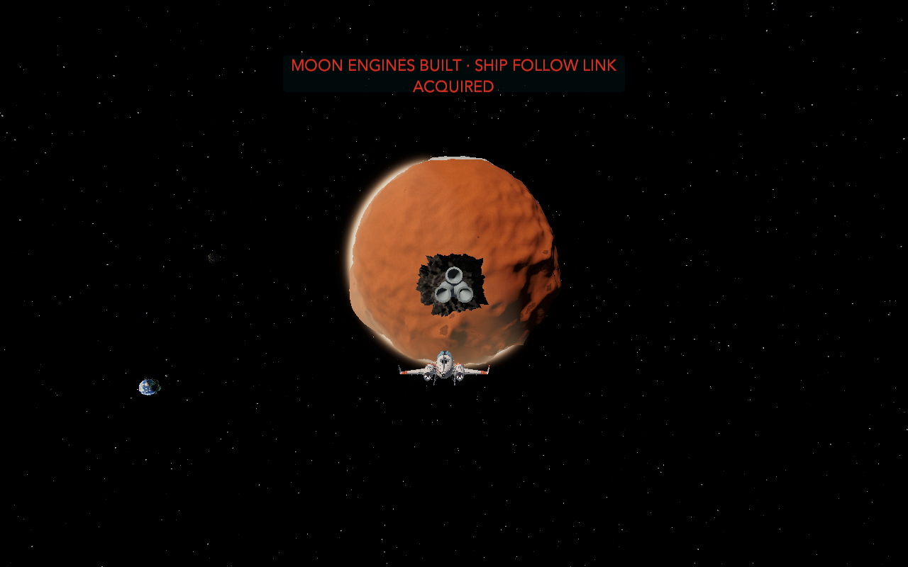

Earth now has three regional burrows before the ship: fists only, then a hand beam, surface thrusters with a 65-metre ceiling and finally the orbital booster. Each region needs a separate factory before Earth is controlled. Combat, discoveries and completed burrows award XP and salvage. Level-ups pause play for one of three upgrades; Equipment spends salvage on damage, fire/charge rate, toughness, energy recharge or repair/reload. Powered fist kills recover energy; rail kills repair armour. Beam damage investment eventually adds chaining. Death restarts the current burrow. See [PLANETS.md](PLANETS.md) for the current progression and proposed distinct encounters on later worlds.
