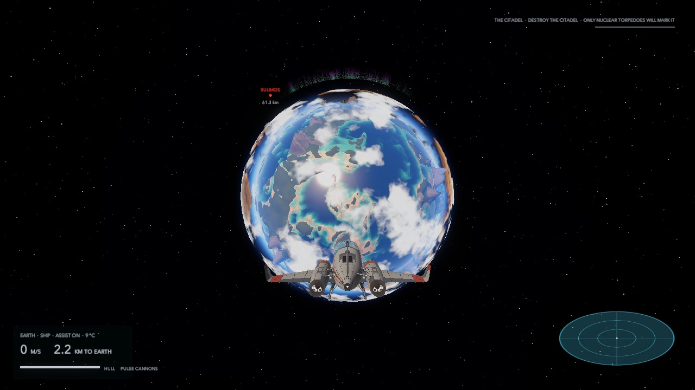
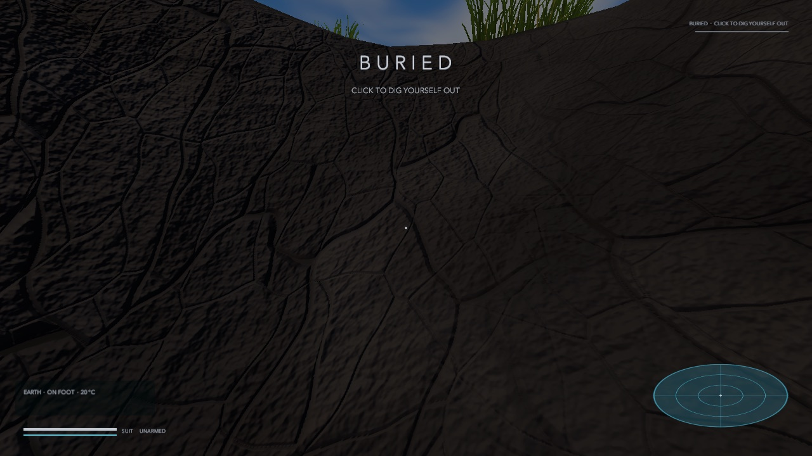
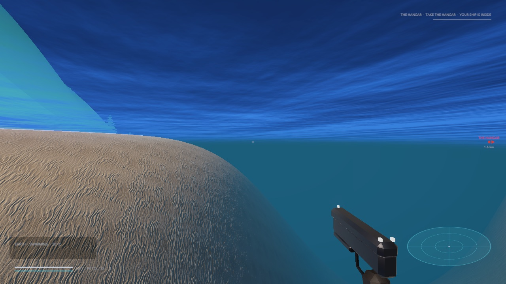
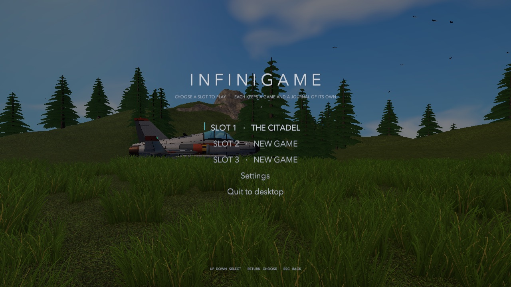
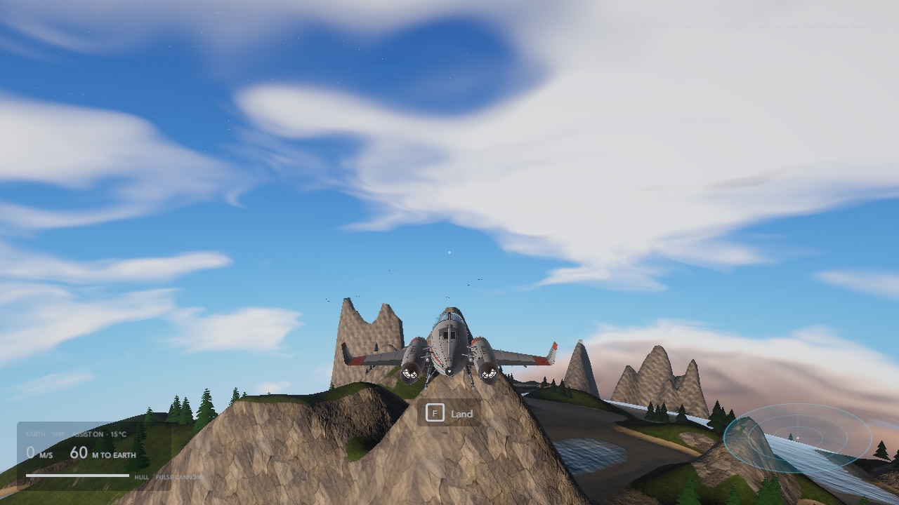
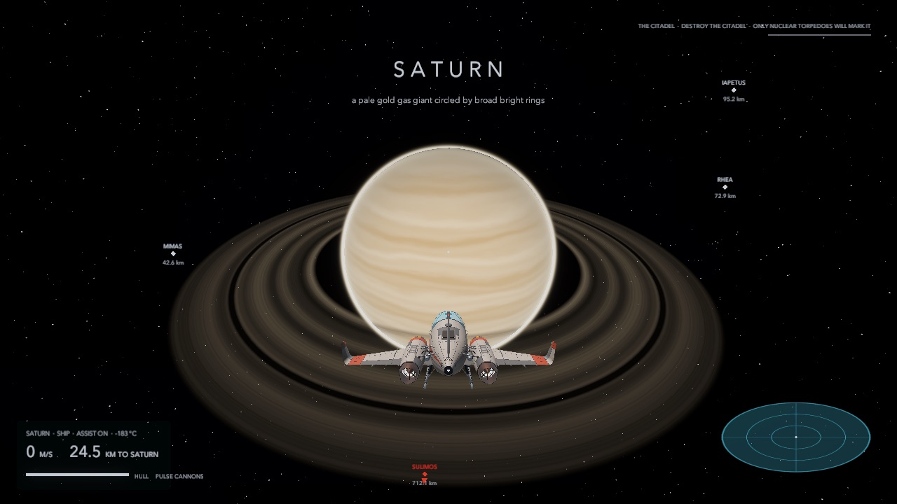
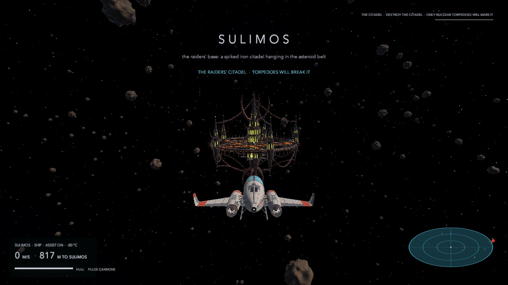
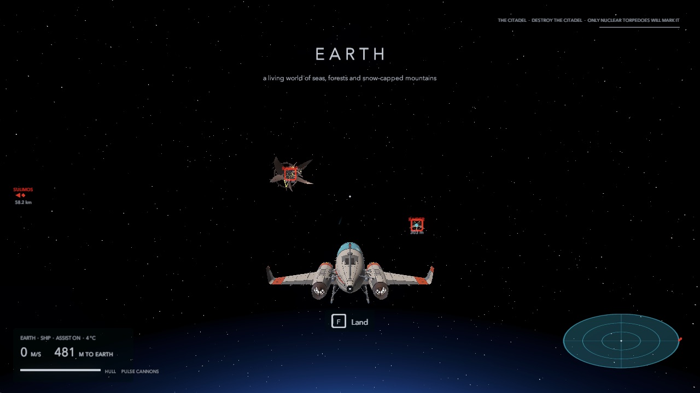
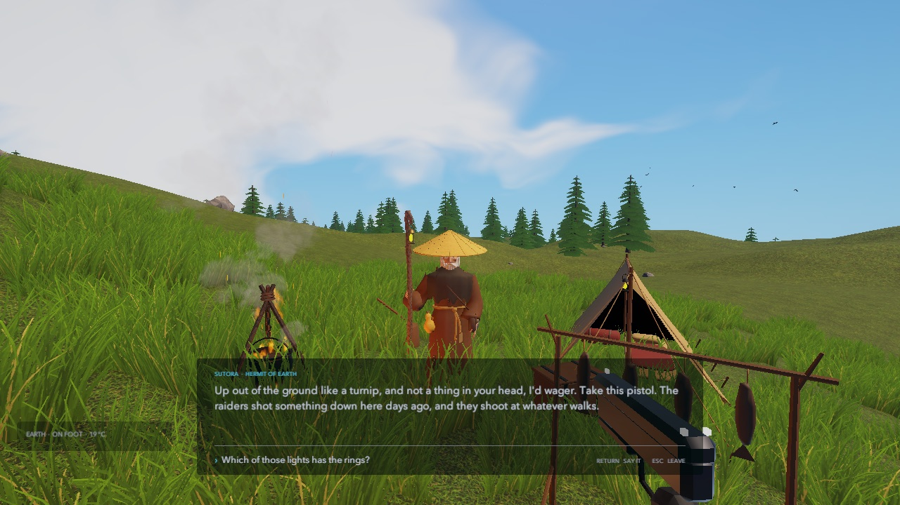
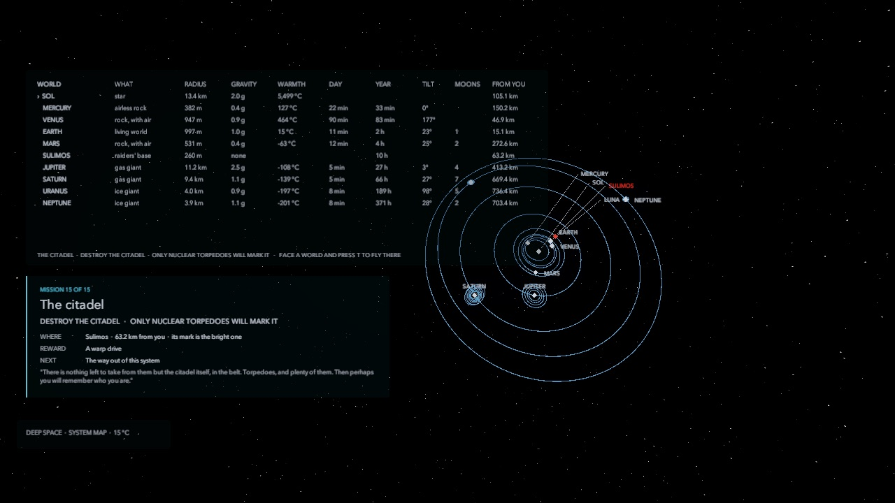

# Infinigame

A tiny procedural copy of our solar system to explore on foot and by ship: a sun, four rocky worlds, an asteroid belt and four giants with their moons and rings, all true spheres with their own gravity. One world is alive, with seas, forests, weather, herds, birds, fish, a moon and a hermit to talk to. Stranger things live elsewhere. Scan anything and Claude or ChatGPT writes its journal entry.

You wake buried, with no memory and nothing in your hands, and dig yourself out. Raiders hold every world of the system. Everything you come to carry, ride and fly is taken from them, a mission at a time: a pistol, a jetpack, a bike, your own ship back, the drive to leave the air, a shield against the radiation beyond the moon, and then world by world stronger weapons, plating and shields, until you hold the nuclear torpedoes that are the only thing their citadel in the asteroid belt cannot shrug off. Its warp drive takes you on to a harder system. Dying costs only the mission in hand.

Built with Unity 6.6 (6000.6.9f1) and URP. Everything is generated from code: terrain, models, textures, materials, the interface, sound effects and music. There are no downloaded assets, though you can drop in music of your own.

| | |
|---|---|
|  |  |
|  |  |
|  |  |
|  |  |
|  |  |
|  |  |
|  |  |

These are frames from the game, taken by `script/test --unity`.

## Scripts

These follow [scripts to rule them all](https://github.com/github/scripts-to-rule-them-all).

| Script | What it does |
|---|---|
| `script/bootstrap` | Installs Unity Hub, the Unity CLI, Anthropic's `ant` and OpenAI's `codex` from the `Brewfile`, then the pinned editor version. Only Unity is required: with no model to ask, the scanner says how to set one up and the hermit keeps to his set words. |
| `script/setup` | Bootstraps, makes sure the current user has a Unity licence and, if they can reach neither Claude nor ChatGPT, signs them in to Claude for the scanner and the hermit. See Setup below. |
| `script/editor` | Opens the game in the Unity editor, on the game scene. Press Play. |
| `script/play` | Plays the game as a standalone app, building it first if the project has changed or the last build has no Burst-compiled code. The game's log goes to `Logs/Player.log` and its frame rate to `Logs/frames.log`. |
| `script/build` | Builds `Build/Infinigame.app` for macOS. Unity's build log goes to `Logs/build.log`. |
| `script/test` | Compiles every assembly and runs the EditMode tests. Needs no Unity licence. |
| `script/test --unity` | Also runs the EditMode and PlayMode tests inside Unity and saves pictures to `Logs/Screenshots`. |
| `script/unity` | Runs the pinned editor against this project with any arguments. |

`script/play`, `script/build` and `script/test --unity` need a licence for whoever runs them and the project closed in the editor.

`Infinigame.app` in the repository root is a link to the latest build, to open from the Finder. Opened that way it does not rebuild itself or write the logs that `script/play` asks for.

`ARCHITECTURE.md` says how the code fits together and `AGENTS.md` what to know before changing it.

## Setup

Unity licences belong to one operating-system user, so each user who runs Unity needs their own.

1. As your normal user, run `script/setup`. It installs Unity with Homebrew and the Unity CLI. Sign in to Unity Hub when it opens so your account has a licence.
2. As any other user that should run Unity from the command line, such as a sandbox user, run `script/setup` in a terminal. It prints a sign-in URL to open in any browser, including one belonging to your normal user, then activates Unity Personal for that user. Two-factor accounts work because the sign-in happens in the browser.

A licence is tied to a network hardware address that changes now and then. Unity Hub refreshes yours; `script/unity` refreshes one activated by `script/setup` before every launch.

`script/test` on its own needs none of this.

### The scanner and the hermit

Their words are written by Claude or by ChatGPT. Which of them, with which model and how much thought, is yours to choose under Settings on the game's menu, where each has a page of its own to sign in from. The game is never built with a key in it and never shows a sign-in form: signing in happens in your browser. It reaches a voice by the first of these that it finds:

1. **A key of your own.** Copy an API key from [platform.claude.com](https://platform.claude.com/settings/keys) or [platform.openai.com](https://platform.openai.com/api-keys) and choose Use the key on the clipboard on that voice's page, or set `ANTHROPIC_API_KEY` or `OPENAI_API_KEY`. The game then asks the maker's API itself, which works on any device, a phone included. Claude Max, Ultra and Team plans [include API credits every month](https://platform.claude.com/docs/en/about-claude/api-credits-for-subscribers), once claimed on claude.ai under Settings, Billing, and so do [ChatGPT Pro and Business plans](https://developers.openai.com/api/docs/guides/chatgpt-api-credits). The key stays in a file on your device and is never shown.
2. **Continue with ChatGPT.** OpenAI's own [Sign in with ChatGPT](https://developers.openai.com/siwc/token-sharing-open-source): approve in your browser, and what the game asks counts against your ChatGPT Plus or Pro plan. It needs no other tool. Anthropic allows no sign-in to Claude inside other people's apps, so Claude has no such road.
3. **The makers' command-line tools**, on a computer, each with the sign-in it keeps for itself. Every one of them can be told to sign in from its voice's page of the menu:
   - Anthropic's [`ant`](https://github.com/anthropics/anthropic-cli) (Sign in with ant, or `ant auth login`) is paid from your account's API credits.
   - [Claude Code](https://code.claude.com) (Sign in with Claude Code, or `claude auth login`) counts against your Claude plan. The game runs it unmodified, with no tools, for one answer at a time. `ant` is used first where both hold a sign-in.
   - OpenAI's [`codex`](https://github.com/openai/codex) (Sign in with Codex, or `codex login`) counts against the Codex use that [every ChatGPT plan includes](https://developers.openai.com/codex/pricing).

Each voice's page shows how you stand with it and what the game has asked of it so far: how many times, the tokens in and out and, for Claude by key or `ant`, about what that cost. While a model is writing, its name and the model's show at the top right of the screen. Put a picture of your own at `Assets/Infinigame/Resources/Icons/Claude.png` or `ChatGPT.png` and it is shown beside the name: the makers' logos are theirs to license, so none ships with the game. Neither maker tells an app what is left of a plan or a balance, so the pages say where to look that up.

Without any of these the game plays as normal and says how to fix it when you scan or talk. Each kind of thing is asked about once per world and then kept in the journal in the save file.

## Play

| Input | On foot | In the ship |
|---|---|---|
| W A S D | run, and once well off the ground with a jetpack fly wherever you look | thrust and strafe |
| Mouse | look | steer |
| Space | jump, hold for the jetpack once you have it, with W to fly forward | lift |
| Ctrl or C | | descend |
| Shift | sprint | boost |
| Q / E | | roll |
| F | talk to the hermit, take what an outpost kept, board the ship | land, then leave |
| Click (hold) | fire | fire |
| 1 to 5 or the wheel | pistol, shotgun, rifle, sniper rifle or missile launcher | pulse cannons, seeker missiles, the lance or nuclear torpedoes |
| R | reload | |
| B | get on or off the bike | |
| Right click | scan what you are looking at | scan the world ahead |
| T | | autopilot to the world you are facing, or a moon near enough to see |
| Z | | flight assist on or off |
| V | | cockpit or chase view |
| Tab (hold) | the map and the mission: of the world you are on until your ship can cross the system, then of the whole system | |
| Return | talk to the hermit, once he flies with you as copilot | |
| G | | warp a system deeper, from open space, once you have the citadel's drive |
| H | show the list of controls; Escape closes it | |
| M | music on or off | |
| [ and ] | lower or raise detail | |
| - and = | slower or faster mouse look | |
| Option-Return | switch between full screen and a window in the standalone app | |
| Escape | pause menu: resume, controls, settings, cheats, a new game, quit to the title page or quit | |

The game opens on its title page, over the world you last played in: choose one of three save slots to play. Settings, there and on the pause menu, hold how much detail is drawn, music, look speed, full screen, whether the hermit is heard as well as read, and who writes for the scanner and the hermit. On foot the weapon in hand is held up in view. Little else is on screen until there is something to say: where you are and how hot it is there, what is left of your suit or hull, what is in your magazine and the mission in hand. Other worlds are named in the sky wherever nothing stands in front of them, and from space each shows how far off it is. A radar at the bottom right shows foes round you in three dimensions: ahead is up the disc, and each blip stands on a stalk as far above or below the disc as the foe is above or below you. Foes in view are boxed, with a mark to aim at. Talking to the hermit is typing: Return says it and Escape leaves.

`script/play` starts full screen at 60 frames a second, in step with the display. In the editor, set the Game view to Play Maximized.

With flight assist on, the ship hovers, follows the horizon and climbs over terrain. With it off the ship is purely Newtonian and can orbit. The autopilot flies to another world many times faster than you may, steers round anything in the way and stops a short way off. Touching the controls takes the ship back.

Your suit mends itself when left alone and the ship is patched up while it sits on the ground. Rings and the asteroid belt are made of rocks, each on its own orbit: striking one dents the hull, and never finishes it. Blasts and hard landings leave craters in the ground, and what is left depends on what was there: soil and grass are charred black, rock runs molten, glows and creeps downhill as it cools, snow and ice melt into a pool, and a shot into the sea boils it to steam. Mars, Io and Venus have volcanoes you can see from orbit, walk up and land on: Mars a few vast dead shields, Io many small cones with lava in their calderas, Venus broad low ones under its cloud. Coming in to land on ground too rough to sit on, the ship drops a landing charge that blasts a level pad for it first. Heat kills: the star cooks a ship that comes close, a giant cooks one that sinks into it, and the furnace world roasts anyone who steps outside. The cockpit and the status line show the temperature outside, in red when it is nearly too much. Everything on the ship's dash is live: speed, range, height, climb, hull, heat and thrust on dials and screens, an attitude ball, a stick and throttle that follow your hands, a selector and lamps for the weapons that are fitted, and switches and warning lamps overhead.

Movement is quick: a run is faster than most games' sprint, a jump taken the moment you land keeps all your speed, and pushing across your own path in the air adds to it. What you carry are firearms: they run dry and are reloaded, they climb as they fire and they scatter when fired fast, on the run or in the air. A ship's guns tear far bigger holes in the ground than anything carried, and a nuclear torpedo leaves a crater you can see from orbit under a mushroom cloud that hangs for most of a minute. Raiders and drones are holed where they are hit, their edges glowing and chunks flying off, and go up in a fireball that rolls into smoke, with burning wreckage tumbling out of it.

Each system has a metal song of its own, written from its seed. It gallops along under a tune while you explore and turns heavy when foes are about. To hear music of your own instead, such as tracks made with Suno, put audio files in `Assets/Infinigame/Resources/Music` (make the folder): those named `explore` and something (`explore1.mp3`, `explore2.wav`) play while you explore and those named `battle` and something play in a fight, one of each for every system. They are set to stream as they are imported, and `script/play` rebuilds the app with them in it.

### The missions

| Mission | Where | What it wins |
|---|---|---|
| Buried | where you wake | daylight |
| The stranger | the hermit's fire near by | a pistol |
| The outpost | a short walk off | a jetpack |
| The depot | further | a shotgun and a bike |
| The hangar | a long ride | a rifle, a missile launcher and your ship, which cannot yet leave the air |
| The gun tower | the far side of Earth | an orbital drive: the moon is in reach |
| Luna | the moon | a radiation shield: the rest of the system is in reach |
| Mars | | seeker missiles |
| Venus | | heat plating and a stronger hull |
| Mercury | | the lance |
| Jupiter | Ganymede | a mender that repairs the hull in flight |
| Saturn | Titan | a sniper rifle and armour |
| Uranus | Titania | bulkheads |
| Neptune | Triton | nuclear torpedoes |
| The citadel | the asteroid belt | a warp drive, and a harder system beyond it |

A mission's place is marked in red, and the world it is on in blue. The mark is never lost: with the ground in the way it stands on the horizon over the way there, and behind you it waits at the edge of the screen with an arrow. The radar carries a mark for it too, and a card sets the mission out in full as it begins and whenever you hold Tab: where it is, what it wins and what comes after. Its guards turn out when you come near: drones for someone on foot, raiders for a ship or for anyone on the ground with a launcher to answer them. Clear them and what they were keeping is left under a beacon to be taken: walk up to its crate and press F or, for what only a ship could carry, land beside it. Then it is yours, and you are made whole. Once your ship is won back the hermit leaves his fire to fly in it as your copilot: Return talks to him from anywhere, he knows how the flight is going, and he speaks up of his own accord. The hermit has something to say about each mission, which needs no model to say it; anything you type to him is answered by Claude or ChatGPT, and with neither to ask he falls back on a few set answers, which the number keys ask for. Cheats, on the pause menu while the game is being made, skip to the next mission, go back one or hand over every weapon and all gear at once. Each of the three save slots on the title page keeps a game and a journal of its own.

### The system

The worlds carry the names of the ones they copy, from Sol and Mercury out to Neptune and Triton, and the planets, their bigger moons and their rings keep their real sizes relative to each other. The star does not, as to scale it would fill the sky, and the home moon is a little small so that it can be walked round in five minutes. Distances are far too short to be to scale, and so is the year. The home world turns once in about ten minutes and goes round its star in twelve of those days, about two hours, so that planets can be seen to move and seasons to turn while you play. Every other year is the real one counted in home years, and days and months are the real ones counted in home days. The two worlds nearest the star are the exception, as their slow spins are tied to their orbits: the scorched rock turns three times in two of its years, and the furnace world turns backwards more slowly than it circles the sun. The moon goes round in 27 days and rocks from side to side as it goes, and one ice giant lies on its side. Orbits are ellipses, swept faster near the star, each in a plane of its own, and every world leans on its real axial tilt. Moons circle over their planet's equator, in the plane of its rings, except the home moon, which keeps near the plane of the planets as ours does.

Storms wander the home world and it rains under them; at night its poles glow. The other worlds are a scorched rock, a furnace under unbroken cloud, a rust desert with polar ice and blue sunsets, and four giants with nothing to land on but their moons. Hold Tab for the map and a table of every world: size, gravity, warmth, day, year, tilt and moons.

