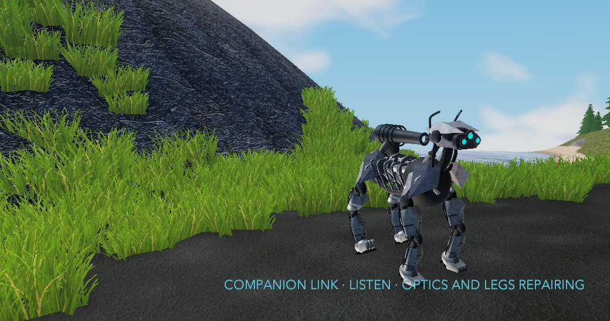

# 🪐 Infinigame

Infinigame is a sci-fi action RPG that mixes first-person shooting, colony building and space dogfights in a procedurally generated solar system. The moon you can see through the trees is somewhere you can land.

## 🎮 Play the beta

- **iPhone and iPad** · [Join the TestFlight beta](https://testflight.apple.com/join/1GUH8Zjn).
- **Apple silicon Mac** · [Download the macOS build](https://nightly.link/MikeMcQuaid/Infinigame/workflows/release/main/Infinigame-macOS.zip) or [join TestFlight](https://testflight.apple.com/join/1GUH8Zjn).
- **Windows, SteamVR and Steam Deck** · Play on a monitor, on a Valve Index or on Deck through Proton. [Download the Windows build](https://nightly.link/MikeMcQuaid/Infinigame/workflows/release/main/Infinigame-Windows.zip)

The desktop links follow the latest successful build on `main`. Open the download and extract the game ZIP inside. [Installation and controls](PLATFORMS.md)

## 🥊 Below the forest floor

The Foundry builds machines to protect the wildlife on the surface. Its rival, the Presence, grows living ships and breeds whole broods underground. In Foundry armour you can punch through a tunnel wall to find another way in. When the creatures close in, a powered punch restores some of your health and energy.

On Valve Index, finger tracking lets you see your armoured fingers curl as you close your hand. Swing a fist to break rock, sight along your wrist to aim the railgun or turn your forearm towards you to call a robodog from your wrist display. In the cockpit, you can look over your shoulder to follow a ship while the gunsight stays on the windscreen.

## 🐾 A colony that carries on without you

Clear a foothold and build a factory. Its first robodog steps off the assembly line and starts patrolling. Call one along on the way to your next burrow and it will guard the entrance while you go inside. Back on the surface, your colony keeps replacing its losses. Once it has a shipyard, robodog pilots can join you in orbit.

## 🚀 From the treetops to orbit

Pick a spot on the horizon, lift off and fly there yourself. Skim a ridge to line up a landing, dogfight a living ship above the atmosphere or set the autopilot and watch a planet’s rings pass the canopy.

Exploration has a roguelike twist. Start a new expedition and a fresh seed redraws the coastlines, raises different mountain ranges and places the burrows somewhere new. Return to a saved expedition and you can fly home to the same patch of ground where you built your first factory.

## 💬 Your travelling companion

The robot can guide you through the whole game offline. Connect an optional language model to give each expedition its own wording for dialogue, mission guidance and scanner observations. You can also type or speak a question about what’s happening where you are. [Language model options](LLMS.md) · [Privacy](PRIVACY.md)

## 🎵 Credits

Infinigame is vibed by Mike McQuaid.

Mike used LLMs to write all the code. He used AI tools to develop the concept art. The soundtrack includes AI-generated music made with Suno. The screenshots on this page were captured in the game.
