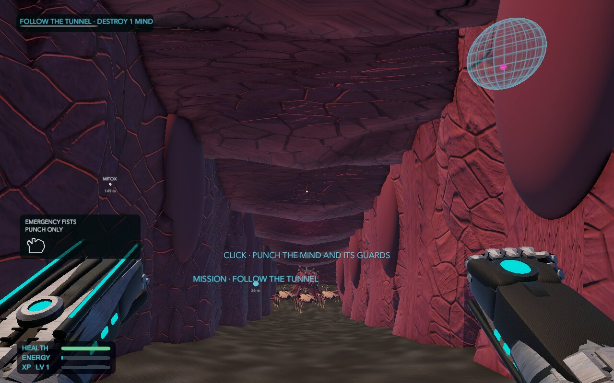
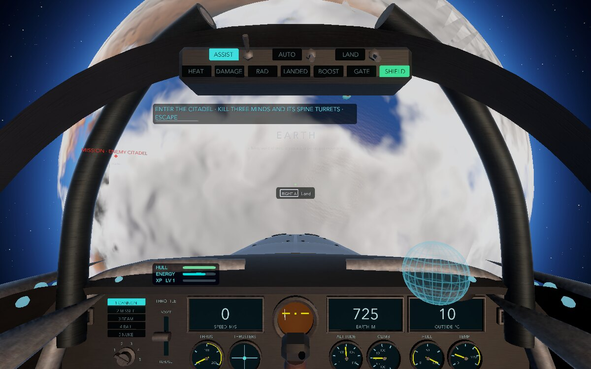

# Infinigame

You wake beneath the rubble with two working fists. Somewhere overhead, your ship is still flying. Punch your way into daylight and follow the voice of the little robot waiting beside the hole.

**Play the Apple beta** on iPhone, iPad or Apple silicon Mac. [Join TestFlight](https://testflight.apple.com/join/1GUH8Zjn)

**Play on Windows, Valve Index or Steam Deck** with the Windows download from a successful main build. The same folder runs on a monitor, in SteamVR or through Proton. [Build downloads](https://github.com/MikeMcQuaid/Infinigame/actions/workflows/release.yml?query=event%3Apush) · [Installation and controls](PLATFORMS.md)

## Beneath the surface

The forest floor hides a second landscape. Follow branching tunnels into the living tissue of a burrow, find the mind growing at its heart and get out before your demolition charge goes off. Back in daylight, build a factory. The first robodogs patrol its grounds while you collect the next piece of your suit.

## Take the pilot’s seat

Launch from the same ground you just crossed on foot. Pick out a moon through the canopy, take an escort past the cloud tops or cut thrust and watch the rings go by. Beyond the first solar system, each seed brings new worlds to land on and explore.

Play solo with a mouse and keyboard, controller, touchscreen or tracked hands. Your robot companion can guide the whole expedition offline. Connect an optional language model for fresh dialogue and lore-aware guidance on each run.

[The worlds](PLANETS.md) · [Building from source](ARCHITECTURE.md#development-commands) · [Privacy](PRIVACY.md)
